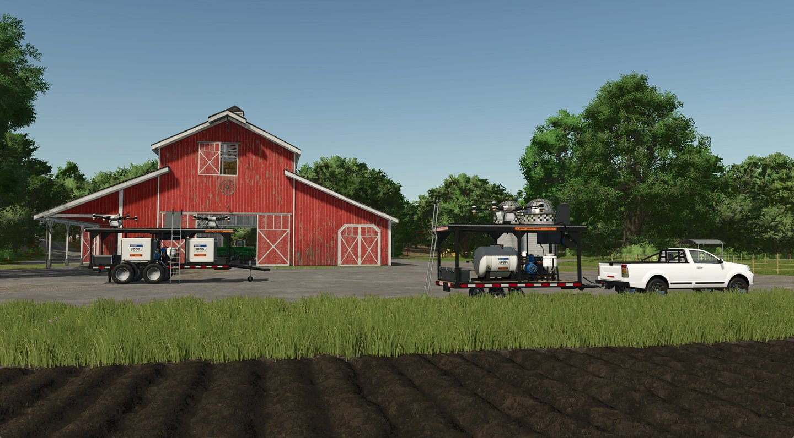
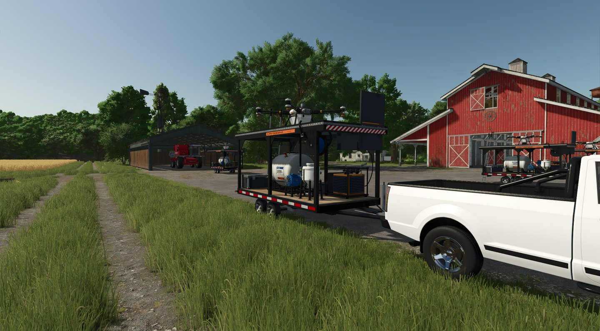
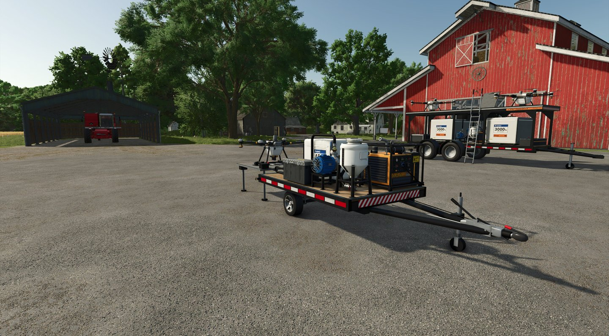
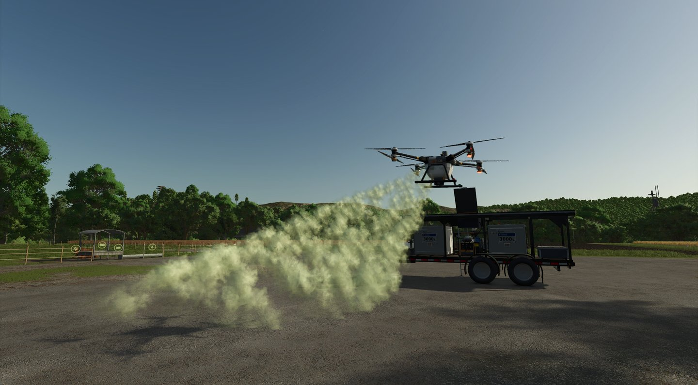
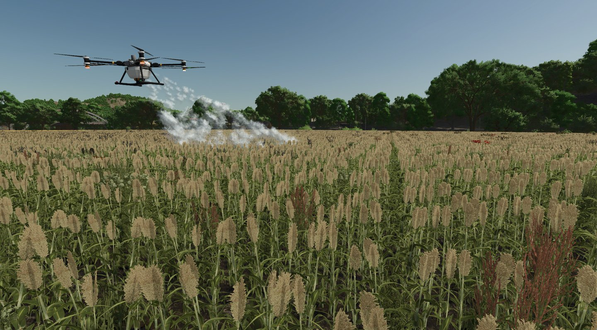
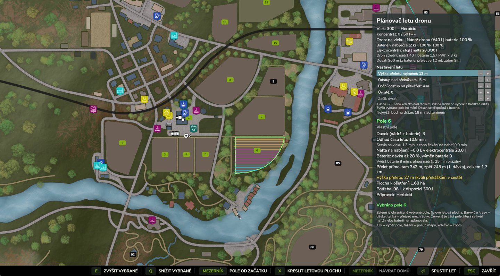
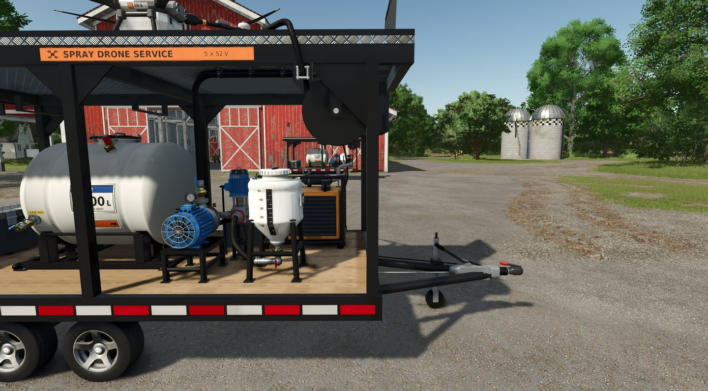
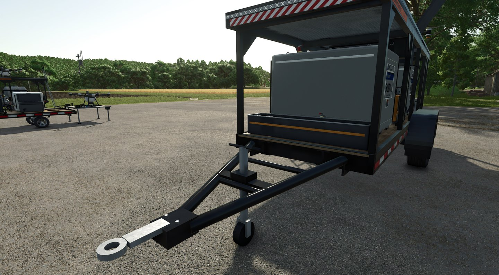

# FS25 Spray Drone Service Trailer

Mod do Farming Simulator 25: servisní vlek pro zemědělský postřikový dron ve třech velikostech (Mini, auto, tandem XL)
s plánovačem letu, výměnou baterií, naftovou centrálou, mixérem koncentrátu, přenosnou relé tyčí a tabletem.

## Galerie

| | |
|---|---|
|  |  |
| Mini, Max a Car (za pickupem) na dvoře farmy | Car: nádrž, čerpadlo, mixér a elektrocentrála na jednom vleku |
|  |  |
| Mini: nejmenší vlek s jedním dronem | Max: tandem pro dva drony, postřik z paluby |
|  |  |
| Dron stříká pole | Plánovač letu na mapě: dávky, přelety a servis na vleku |
|  |  |
| Naftová centrála, mixér koncentrátu a čerpadlo | Max zepředu: oj, nádrže 3000 l a nabíječka |

## Instalace

Složku `mod/FS25_SprayDroneTrailer` zabal do `FS25_SprayDroneTrailer.zip` (obsah složky v kořeni zipu) a vlož do
`Documents/My Games/FarmingSimulator2025/mods`.

## Struktura

| složka | obsah |
|---|---|
| `mod/FS25_SprayDroneTrailer` | hotový mod: Lua skripty, XML, modely i3d, textury dds, překlady |
| `blender/` | skripty, které modely vleků, dronu a doplňků staví v Blenderu a exportují do modu |
| `blender/templates` | šablony XML vleků, které export doplní |
| `tools/` | kontroly modu (Lua, XML, kolize, savegame) a výroba textur |
| `assets/fonts` | písma pro polepy a loga (licence OFL u každého písma) |
| `assets/gallery` | snímky z hry pro tento README |

## Sestavení modelů

Potřeba je Blender 5.x a doplněk GIANTS I3D Exporter (`io_export_i3d_reworked`, není součástí repozitáře).

Cesty ke hře a k Blenderu: proměnné prostředí `FS25_GAME_DIR` a `SDT_BLENDER`, nebo soubor `local_paths.json`
v kořeni repozitáře (není v gitu). Bez nich se použije výchozí instalace ze Steamu a `blender` z PATH.

```json
{
    "FS25_GAME_DIR": "C:/Program Files (x86)/Steam/steamapps/common/Farming Simulator 25",
    "SDT_BLENDER": "C:/Program Files/Blender Foundation/Blender 5.1/blender.exe"
}
```

```
blender -b --python blender/headless_middle.py -- build export
blender -b --python blender/headless_max.py -- build export
blender -b --python blender/headless_mini.py -- build export
blender -b --python blender/build_link_items.py -- tablet
```

Kontroly bez Blenderu: `python tools/check_all.py --no-build` (potřebuje `lupa`, `numpy`, `Pillow`).

## Licence

Mod (kód, modely, textury, logo BZUK a ostatní designy) je pod licencí
[Creative Commons BY-NC-SA 4.0](https://creativecommons.org/licenses/by-nc-sa/4.0/), plné znění je v souboru `LICENSE`:
smíš ho upravovat a šířit dál s uvedením autora (Pavel Mazálek), ne komerčně a pod stejnou licencí.

Výjimky: písma v `assets/fonts` mají vlastní licenci SIL OFL (soubory `OFL-*.txt`), zvuk rotoru je CC0
(`licenses/sounds_LICENSE.txt`).
