# Servisní vlek pro postřikové drony – uživatelský manuál

---

## 1. Co to je

Servisní vlek pro zemědělské postřikové drony. Vlek odstavíte u pole, rozložíte ho a let naplánujete na mapě. Dron pak pole postříká (nebo vápní, nebo naskenuje) **sám**: létá po řádcích, když dochází nádrž nebo baterie, vrátí se na vlek, doplní se, vymění baterii za nabitou a pokračuje, dokud není pole hotové.

Z čeho se systém skládá:

| Část | Co dělá |
|---|---|
| **Vlek** (Mini / Middle / XL) | Nese nádrž na přípravek, naftovou elektrocentrálu s nabíječkou baterií, míchačku koncentrátu, úložiště kanystrů a přistávací plošinu (plošiny) pro dron(y). |
| **Postřikový dron** (S / M / L) | Létá po trase a stříká. Kupuje se zvlášť a staví se na plošinu. |
| **Plánovač letu** | Mapa přes celou obrazovku: vyberete pole, vidíte trasu, dosah a varování a spustíte let. |
| **Baterie + elektrocentrála** | Dron létá na bateriích; naftová elektrocentrála na vleku nabíjí náhradní. |
| **Míchačka + nádrž na koncentrát** | Místo tun hotového přípravku vozíte vodu a malé množství koncentrátu. |
| **Relé tyč, antény, tablet** | Prodlužují dosah rádia a umožňují otevřít plánovač i daleko od vleku. |
| **Vodní pumpa, mlýnek na vápno, násypka na vápno, big bag** | Další logistika: napuštění nádrže z rybníka nebo IBC, mletí a podávání vápna. |
| **Kufr se skenovacím dronem / kufr se vzorkovacím dronem** | Přenosné průzkumné drony: mapa skenu pole a odběr půdních vzorků (Precision Farming). |

---

## 2. Tři vleky

### 2.1 Middle (univerzální)

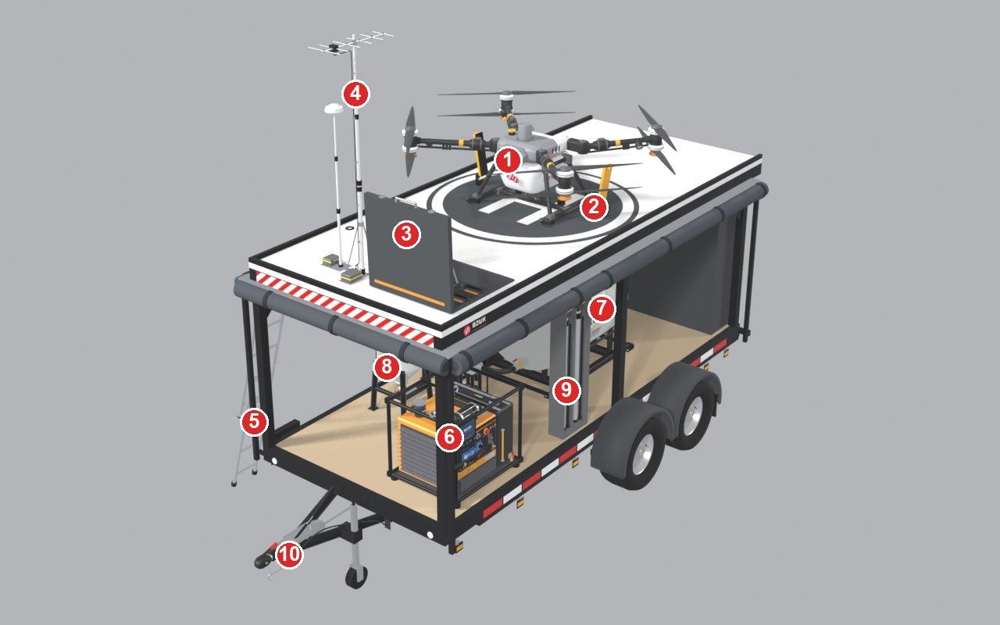

1. Dron na přistávací plošině (jeden dron: S, M nebo L)
2. Přistávací plošina (heliport „H“)
3. Truhla s nabíječkou baterií (víko se otevře při rozložení vleku; sloty na náhradní baterie)
4. Anténní stožár a přijímač RTK GPS (volitelné, z konfigurace v obchodě)
5. Žebřík (sklápí se na pravé straně)
6. Naftová elektrocentrála + nabíječka (oranžová skříň)
7. Hlavní nádrž (800 / 1 000 / 1 500 / 3 000 / 5 000 l)
8. Indukční nádobka (na koncentrát) s míchačkou
9. Skříň na kanystry (48 slotů po 20 l, rolovací dveře vzadu)
10. Oj (spojka)

### 2.2 XL (dva drony)

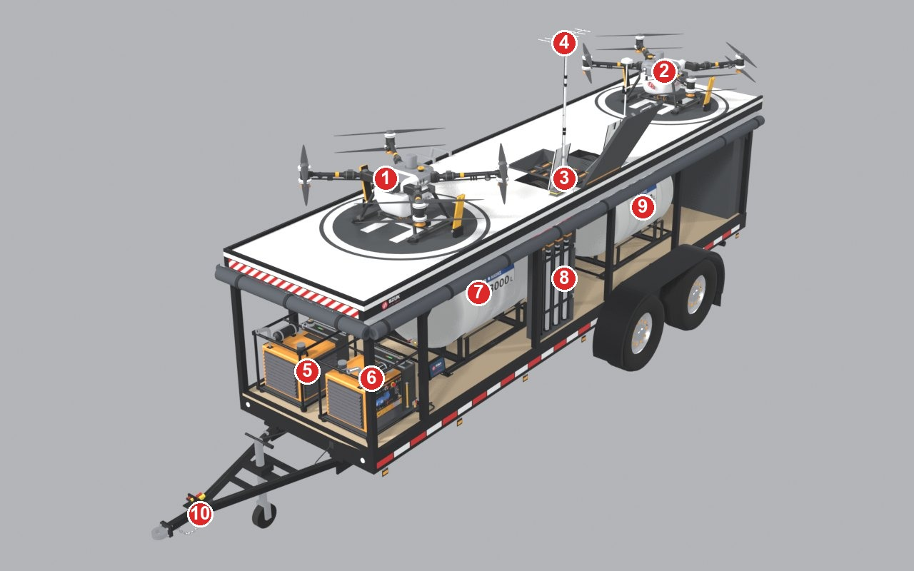

1. Dron 1 na plošině 1
2. Dron 2 na plošině 2
3. Truhla s nabíječkou baterií mezi plošinami
4. Anténní stožár
5. Elektrocentrála A
6. Elektrocentrála B
7. Nádrž A (3 000 nebo 5 000 l)
8. Skříň na kanystry (48 slotů, mezi nádržemi)
9. Nádrž B
10. Oj (ve výchozím stavu traktorové oko; kulová spojka jako u osobních aut je volitelná)

Vlek XL nese **dva drony, které spolupracují**: plánovač řídí oba najednou a trasu mezi ně rozdělí. Každý dron má vlastní hadici a naviják. Na obou plošinách musí být drony **stejné velikosti**. XL má vzadu také kulovou spojku pro vozík s mlýnkem na vápno.

### 2.3 Mini (kompaktní, bedna)

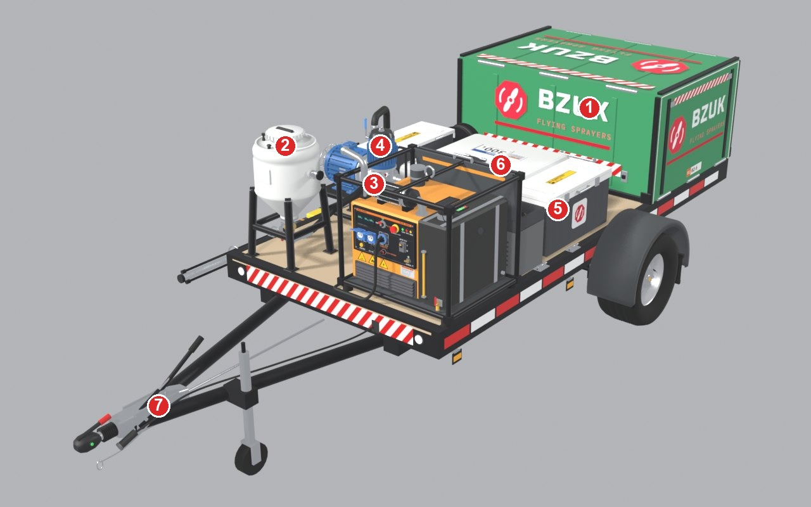

1. Bedna na dron (zelená bedna; při složeném vleku zůstává dron uvnitř)
2. Indukční nádobka (na koncentrát)
3. Elektrocentrála + nabíječka
4. Pumpa a míchačka (modrá)
5. Boxy na kanystry (dva boxy, každý na 4 kanystry)
6. Nádrž 300 l
7. Oj

Zvláštnosti Mini: jediný malý dron (S), nádrž 300 l, pracovní záběr 6 m. Bedna se rozloží na plošinu stojící na nohách. **Dron se animací nepřesouvá**: mezi bednou a plošinou ho přenášíte sami (`R` s prázdnýma rukama na druhém místě). Mini s dronem na plošině nejde složit („Nejdřív přendej dron do bedny“).

### 2.4 Porovnání

| | Mini | Middle | XL |
|---|---|---|---|
| Drony | 1 (S) | 1 (S / M / L) | 2 (S / M / L, oba stejné) |
| Nádrž | 300 l | 800 – 5 000 l | 6 000 nebo 10 000 l (2 nádrže) |
| Pracovní záběr | 6 m | 6 / 9 / 11 m | 2 × 6 / 9 / 11 m |
| Náhradní baterie | 0 – 4 | 0 – 6 | 0 – 10 |
| Žebřík | – | ano (pravá strana) | ano (pravá strana) |
| Úložiště kanystrů | 2 × 4 sloty | 48 slotů | 48 slotů |
| Možnosti antény a RTK | – | ano | ano |
| Zadní spojka pro vozík s mlýnkem | – | – | ano |
| Orientační cena (jen vlek) | 3 900 $ | 6 100 $ | 48 000 $ (s drony) |

(Ceny: viz herní obchod; ve vaší hře se mohou lišit.)

---

## 3. Drony

| | **S** | **M** | **L** |
|---|---|---|---|
| Třída modelu | podobný DJI T25 | podobný DJI T50 | podobný DJI T100 |
| Nádrž | 20 l | 40 l | 75 l |
| Pracovní záběr | 6 m | 9 m | 11 m |
| Doba letu, plná nádrž | ~9 min | ~8 min | ~6 min |
| Dosah rádia (základní) | 300 m | 450 m | 600 m |
| Rychlost plnění | 1 l/s | 1,5 l/s | 2,5 l/s |
| Limit větru pro postřik | 5 m/s | 6 m/s | 7 m/s |
| Cena (obchod BZUK) | 7 000 $ | 12 000 $ | 22 000 $ |

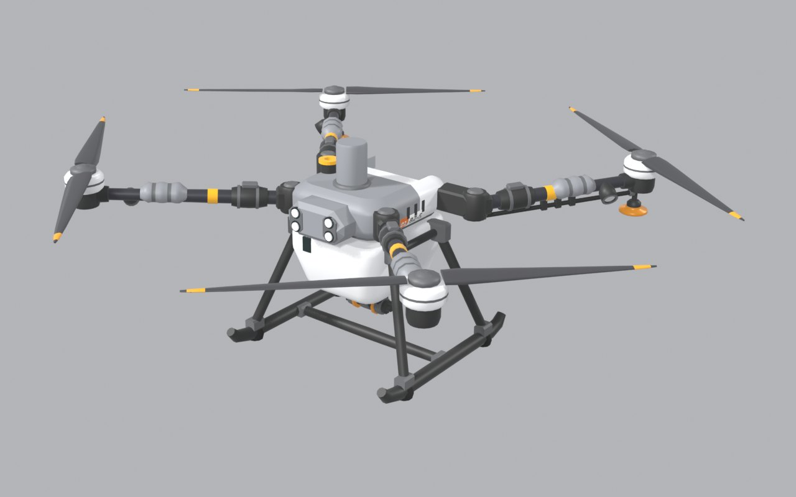
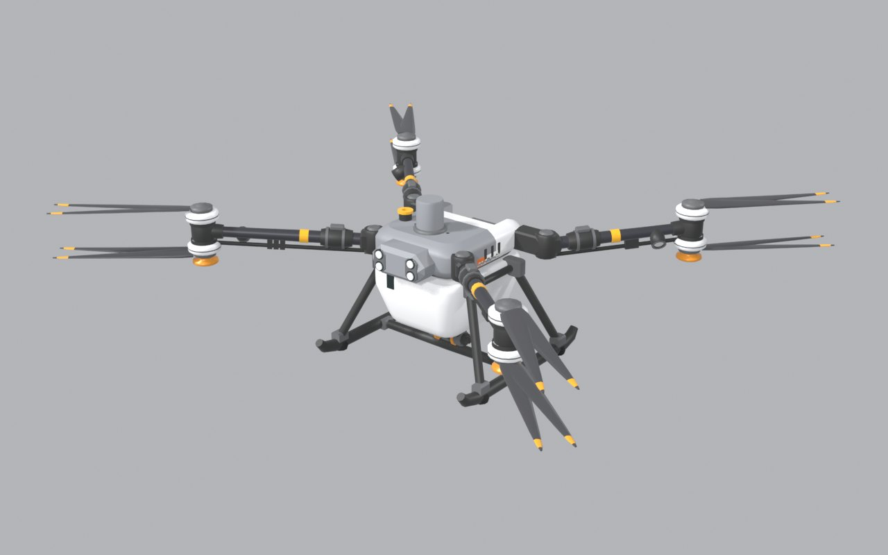
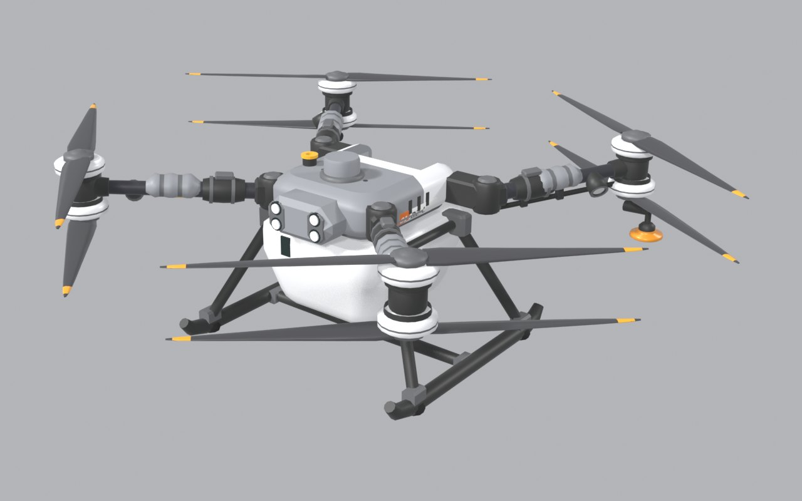

Dron je **předmět nošený v ruce**, prodávaný v obchodě BZUK (kategorie Drony / Vybavení dronů). Zvedněte ho a u přistávací plošiny stiskněte **`R`**, tím ho nasadíte. Sundáte ho stiskem `R` s prázdnýma rukama u obsazené plošiny (ne během mise; rozložený dron se nejdřív složí). Dron si nechá obsah nádrže. Velikost dronu jde měnit jen u složeného vleku.

Navigační světla (jako u skutečných zemědělských dronů): vpředu vlevo **červené**, vpředu vpravo **zelené**, vzadu **bílé, blikající**. Svítí jen, když dron běží.

Další drony (přenosné kufry, viz kapitola 11): **C** (skenovací dron), **P** (vzorkovací dron).

---

## 4. Rychlý start (postřik pole)

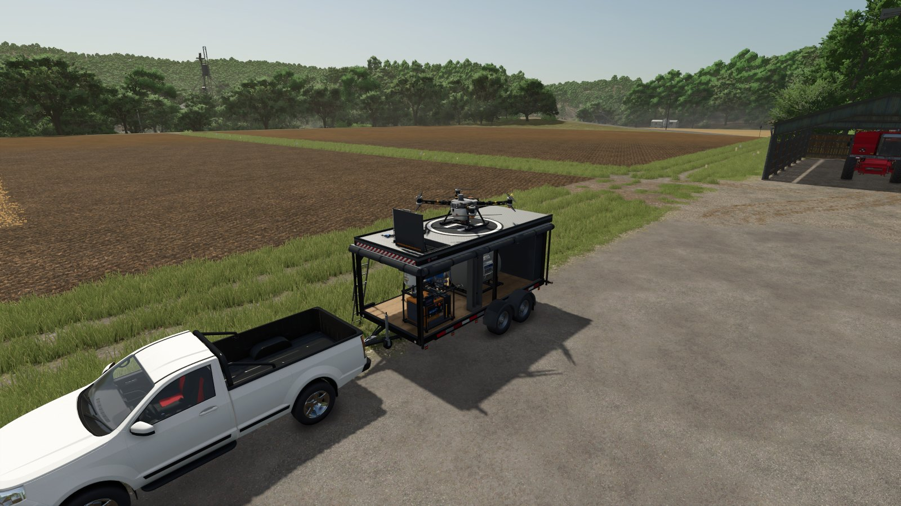
*Ve hře (anglické rozhraní): vlek Middle za pickupem, rozložený vedle pole. Otevřené víko na palubě je truhla s nabíječkou baterií.*

1. **Dojeďte** k poli traktorem nebo pickupem. Zaparkujte na rovném terénu – vlek se dá rozložit, jen když stojí s **náklonem nejvýš 5°** (zobrazuje se v panelu nápovědy, dokud je složený).
2. **Natankujte** elektrocentrálu (kanystr s naftou: nakloňte ho nad hrdlo elektrocentrály, nebo u ní stiskněte `R`). Elektrocentrálu zapněte: **`B`** (stojíte u výfuku, nebo z vozidla).
3. **Rozložte** vlek: **`X`** (z traktoru nebo od vleku). Otevře se víko nabíječky, sklopí se žebřík, dron rozloží ramena a pak vrtule.
4. **Naplňte nádrž** (viz kapitola 6): hotové hnojivo / herbicid, **nebo** voda + koncentrát.
5. **Otevřete plánovač**: nastupte a stiskněte **`Alt+7`**, nebo klikněte levým tlačítkem na displej na vleku, nebo držte **tablet** a klikněte levým tlačítkem.
6. **Klikněte na mapě na pole** (vlastní, nebo přijatou zakázku na hnojení/herbicid). Objeví se trasa. Zkontrolujte varování na kartě plánu.
7. **Start**: `Enter` v plánovači nebo **`Alt+8`**.
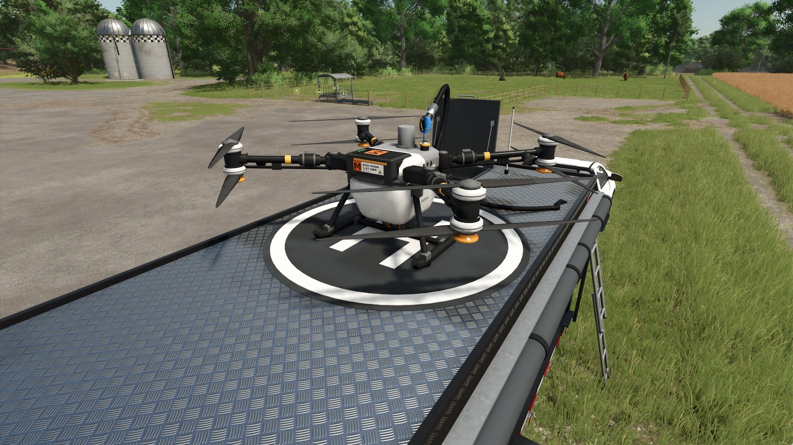
*Ve hře: dron na plošině při obsluze – z nádrže vleku se plní hadicí a podle potřeby dostane čerstvou baterii.*

8. Dron vzlétne, stříká, vrací se k obsluze a opakuje to, dokud není pole hotové („pole je hotové“). Od vleku můžete odejít; let pokračuje.
9. **Návrat domů** kdykoli: `Space` v plánovači nebo **`Alt+0`**. Při dalším startu se pokračuje jen tam, kde je pole ještě neošetřené.
10. Vlek složte klávesou **`X`**, až dron přistál a vrtule se zastavily.

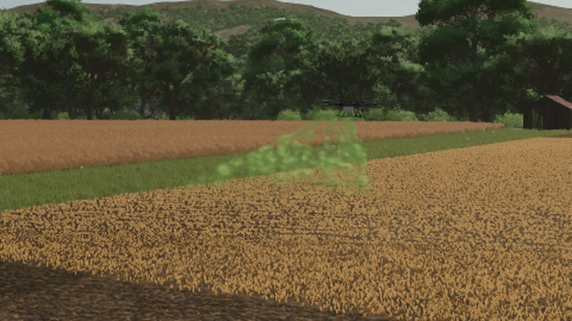
*Ve hře: dron (malý tmavý tvar nahoře v mlze) stříká řádek; zelená barva mlhy znamená tekuté hnojivo (herbicid je modrý, vápno bílé, voda šedomodrá).*

---

## 5. Ovládání

### 5.1 Pěšky

| Klávesa | Akce |
|---|---|
| **`R`** | Brát / pokládat / ukládat věci: nasadit nebo sundat dron, vložit nebo vyndat baterii, vzít / připojit / pustit hadici, vylít kanystr, otevřít víko kufru, nabídka kanystrů u skříně, rozložit nebo složit relé tyč, uložit nebo vzít pumpu či tyč v jejich držácích. |
| **Levé tlačítko myši** | Použít držený tablet (otevře plánovač); kliknout na displej vleku (otevře plánovač); otevřít/zavřít víka boxů na kanystry; klikat na ovládací prvky strojů (rozvaděč mlýnku, páky ventilů, přepínač vstupu pumpy, opěry násypky); u otevřeného kufru se vzorkovacím dronem: odeslat vzorky. |
| **`B`** | Stroj zap./vyp.: pumpa, motor násypky, motor mlýnku, elektrocentrála (u jejího výfuku), relé tyč (rozložená). |
| **`X`** | Složit / rozložit vlek (a vozík s mlýnkem na vápno). |
| Prostřední tlačítko myši | Otáčet neseným kanystrem. |

Je-li k dispozici víc akcí, hra nabídne tu **nejbližší**; zamíření zaměřovače na předmět se počítá, jako by byl o 1,5 m blíž.

### 5.2 Ve vleku (jako pilot)

| Klávesa | Akce |
|---|---|
| **`Alt+7`** | Otevřít plánovač letu |
| **`Alt+8`** | Spustit let (musí být vybráno pole) |
| **`Alt+0`** | Návrat na vlek |
| **`Alt+9`** | Pohled z dronu (kamera na dronu); `C` přepíná mezi pohledem z dronu a z vleku |
| `Alt+5` | Zobrazit / skrýt čáry kreslené ve světě (dosah, trasa, obrys pole, letová plocha) |
| `Alt+1` | Vypustit nádrž dronu do vleku (dalším stiskem zastavit) |
| `Alt+2` | Přečerpat nádrž vleku do IBC do 6 m (dalším stiskem zastavit) |
| `Ctrl+I` | Vypustit nádrž na koncentrát do kanystrů / na zem |
| `B` | Elektrocentrála zap./vyp. (i z traktoru s vybraným vlekem) |
| `X` | Složit / rozložit |

Všechny akce jsou běžné herní vstupní akce, takže je lze v nabídce ovládání **předefinovat**. `Alt+1` a `Alt+2` jsou zaregistrovány vždy, ale když nic nedělají, jsou v panelu nápovědy skryté; stisk pak nic neudělá, takže se neruší klávesy tempomatu traktoru.

### 5.3 V plánovači

| Klávesa | Akce |
|---|---|
| `Enter` | Spustit let |
| `Space` | Návrat domů |
| `Esc` | Zavřít |
| `End` | Začít pole znovu od začátku (u vzorkovacího dronu: odeslat vzorky) |
| `X` | Kreslit / upravit **letovou plochu** (viz 7.4) |
| `C` | Při kreslení odebrat poslední bod |
| `Backspace` | Smazat letovou plochu |
| `Q` / `E` | Změnit vybrané nastavení; na stránkách Pole a Mapa skenu listovat stránkami |
| `PageUp` / `PageDown` | Přepnout na další/předchozí dron nebo kufr |
| Myš | Klik = výběr pole; tažení = posun mapy; kolečko = zoom |

---

## 6. Plnění vleku

Vlek má tři nádrže:

1. **Hlavní nádrž** – voda, hotové tekuté hnojivo, herbicid (a vápenná kaše, viz kapitola 10).
2. **Nádrž na naftu** (30 l) pro elektrocentrálu.
3. **Nádrž na koncentrát** – koncentrované hnojivo, koncentrovaný herbicid nebo jemné vápno. Kapacita je 5 % hlavní nádrže.

### 6.1 Hotový přípravek („přímo“)
Tekuté hnojivo nebo herbicid naplňte do hlavní nádrže (z plnicí stanice, IBC nebo vanilla nádrže). Dron se plní z ní; koncentrát se nepoužívá.

### 6.2 Voda + koncentrát („míchání“)
Do hlavní nádrže naplňte **vodu** a do nádrže na koncentrát **koncentrát** (z 20litrových kanystrů – nakloňte kanystr nad hrdlo indukční nádobky). Při plnění dronu míchačka odebírá vodu a koncentrát současně ve správném poměru:

| Přípravek | Poměr míchání |
|---|---|
| Tekuté hnojivo | 5 % koncentrátu + 95 % vody |
| Herbicid | 5 % koncentrátu + 95 % vody |
| Jemné vápno | 20 % vápna + 80 % vody |

Jeden 20litrový kanystr tedy dá 400 l přípravku. Plánovač ukazuje, co je k dispozici a co to omezuje:
*„Míchání: voda + koncentrát (5 % koncentrátu, 95 % vody) → Tekuté hnojivo“*, *„K dispozici 350 l přípravku (omezuje voda)“*.

Hlášky: **Chybí koncentrát** (voda v hlavní nádrži, koncentrát prázdný) · **Chybí voda** (koncentrát je, hlavní nádrž prázdná) · **Nádrž vleku je prázdná**.

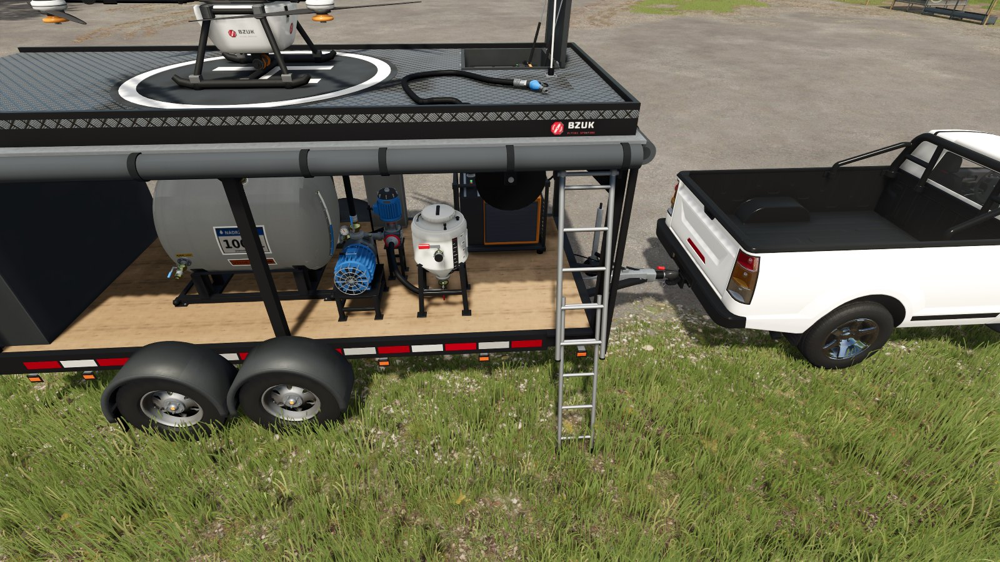
*Ve hře, pravý bok: hlavní nádrž, pumpa a míchačka (modrá), bílá indukční nádobka na koncentrát, sklopený žebřík a na palubě truhla s nabíječkou s hadicí smotanou vedle plošiny.*

### 6.3 Kanystry a skříň na kanystry

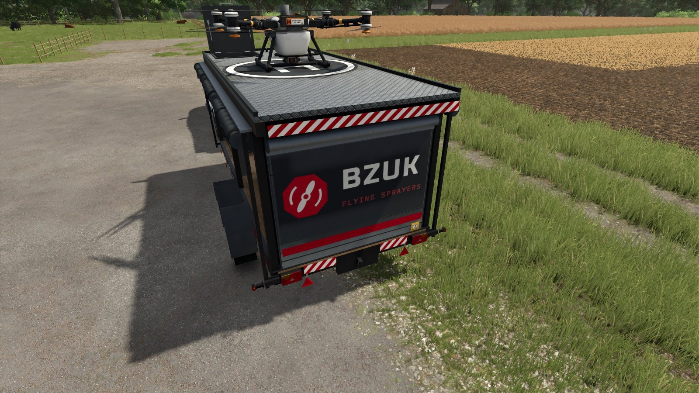
*Ve hře, záď: rolovací dveře skříně na kanystry (48 slotů).*
Kanystry (20 l: koncentrát hnojiva, koncentrát herbicidu, nafta) jsou skutečné předměty kupované v obchodě. Podržte kanystr nad **otevřeným** boxem a uloží se; prázdné kanystry a kanystry nad 20 l se nepřijmou. Levé kliknutí otevře/zavře víko (Mini: dva boxy) nebo rolovací dveře (Middle/XL); **`R`** zobrazí nabídku kanystrů, ze které kanystry vyndáte nebo do nových kanystrů vypustíte nádrž na koncentrát. Ze skříně se do nádrže přímo nelije – jen z kanystru v rukou.

---

## 7. Plánovač letu

Otevře se klávesou `Alt+7`, kliknutím na displej nebo tabletem. Plánovač je herní mapa přes celou obrazovku vystředěná na vlek, s tmavým panelem vlevo a **kartou plánu** vpravo.

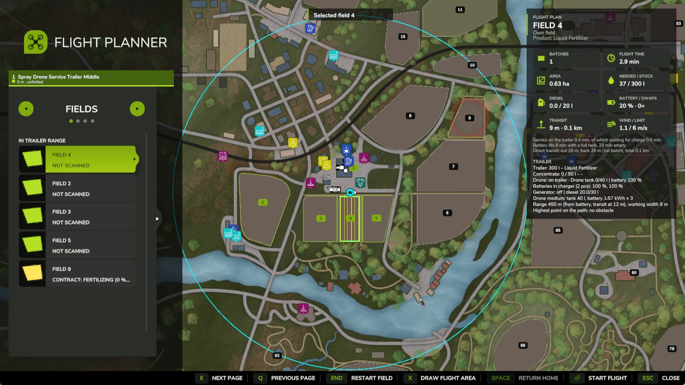
*Ve hře (anglické rozhraní): plánovač s vybraným polem 4. Vlevo: volba stránky a seznam polí; uprostřed: mapa s azurovým kruhem dosahu a trasou (žlutooranžové řádky); vpravo: karta plánu.*

### 7.1 Symboly na mapě

| Symbol | Význam |
|---|---|
| Oranžový čtverec „VLEK“ / vlek | Vlek |
| Azurový čtverec | Dron ve vzduchu |
| Azurový kruh | Dosah rádia |
| Obrysy polí | zelená = vaše pole, zlatá = zakázky, šedá = mimo dosah / nepovoleno, tlustá zelená = vybrané, bílá + bublina = pod kurzorem |
| Barevné čáry | Trasa; **barva = dávka** (jedna dávka = jedna náplň nádrže/baterie) |
| Bílé přerušované čáry | Přelety vlek ↔ dávka (po skutečné, vyhlazené dráze) |
| Červené tečky | Překážky s výškou v metrech |
| Fialová plocha | Letová plocha (viz 7.4) |
| Tečky v barevných dlaždicích | Vrstvy mapy skenu (kapitola 11) |

### 7.2 Levý panel – čtyři stránky
(Přepínají se tečkami stránek, nebo `Q`/`E`.)

- **Fields** (Pole) – seznam polí v dosahu, na kterých smí dron pracovat (vlastní i zakázky), plus další vlastní pole. Každý řádek ukazuje nejnaléhavější nález ze skenu (plevel, zralé, chybí vápno, nehnojeno) a stáří mapy skenu. Klik = výběr a vycentrování mapy.
- **Mission** (Mise) – druh mise (postřik / sken pole – režim skenu určuje typ dronu), způsob aplikace (*celé pole / podle skenu*), počet dronů v misi (XL).
- **Flight** (Let) – výška přeletu, odstup nad překážkami a vedle nich, počet kol úvratí, zda začít úvratěmi, nebo řádky.
- **Scan map** (Mapa skenu) – vrstva mapy k zobrazení a legenda barev trasy a dosahů.

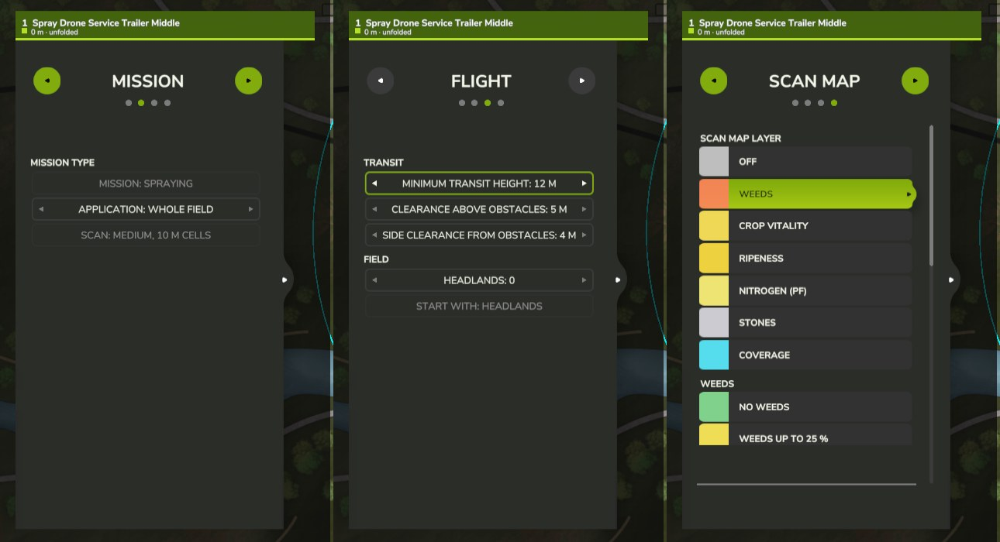
*Ve hře (anglické rozhraní), další tři stránky: „Mission“ (Mise), „Flight“ (Let) a „Scan map“ (Mapa skenu). Výchozí hodnoty na stránce Flight (Let): minimální výška přeletu 12 m, odstup nad překážkami 5 m, boční odstup 4 m, úvratě 0.*

### 7.3 Karta plánu
Zobrazuje: název pole, přípravek, barevná varování (červená = nelze letět, oranžová = pozor, zelená = hotovo, fialová = letová plocha) a dlaždice s údaji: **dávky**, **čas letu**, **plocha**, **potřeba / zásoba** (litry), **nafta**, **baterie na dávku / výměny**, **přelet** (výška a délka), **vítr / limit**. Pod nimi: doba servisu na vleku (včetně čekání na nabíjení), výdrž baterie, úspora ze skenu a stav vleku (nádrže, míchání, drony, baterie, elektrocentrála, dosah, nejvyšší bod na dráze).

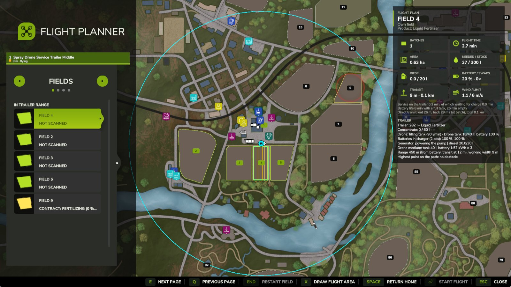
*Ve hře (anglické rozhraní): týž plánovač během letu. Řádek vleku ukazuje „flying“ (letí); karta plánu ukazuje plnění dronu (18 / 40 l) a stav baterie.*

### 7.4 Letová plocha (obletění budov a stromů)
Vyberte pole, stiskněte **`X`** a klikáním do mapy obtáhněte mnohoúhelník (nejvýš 64 bodů), který spojuje vlek s polem kolem překážek. Kliknutím na první bod (nebo opět `X`, od 3 bodů) ho uzavřete. `C` odebere poslední bod, `Esc` zruší, `Backspace` plochu smaže. Dron pak přelétá jen uvnitř plochy nebo nad polem. Plocha patří k poli a ukládá se. Pokud vlek stojí mimo ni (o víc než 6 m) nebo plocha nedosahuje k poli, plánovač zobrazí červenou hlášku a let nejde spustit.

### 7.5 Nastavení letu
- **Úvratě** 0–4 kola kolem okraje pole; **začít** úvratěmi, nebo řádky.
- **Výška přeletu** minimální; plánovač ji nad překážkami nalezenými paprskovým testem sám zvýší. Přesahuje-li překážka limit výšky, přeparkujte vlek.
- **Drony v misi** (XL).

### 7.6 Jak funguje trasa
Přes mnohoúhelník pole se spočítají rovnoběžné řádky (tam a zpět) s rozestupem podle pracovního záběru, oříznou se dosahem rádia a rozdělí se na **dávky**. Jedna dávka je tolik práce, kolik dron zvládne s jednou nádrží a baterií, která je právě v něm, včetně cesty tam a zpět. Za letu se trasa přepočítává každých 5 s, takže hotové řádky mizí. Ošetřené plochy si pamatuje vlastní stav polí ve hře, takže se neukládá nic zvláštního.

---

## 8. Baterie a elektrocentrála

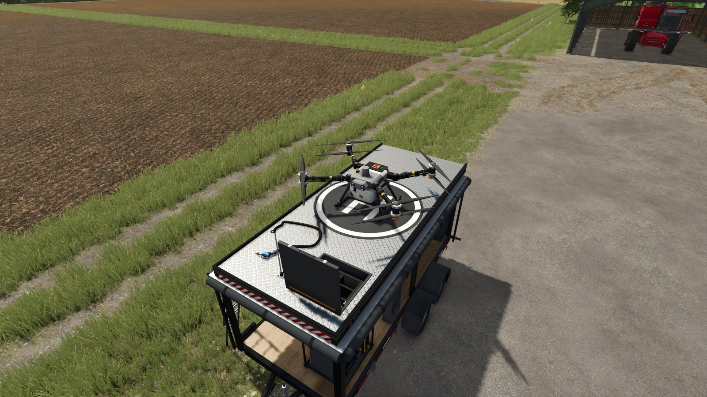
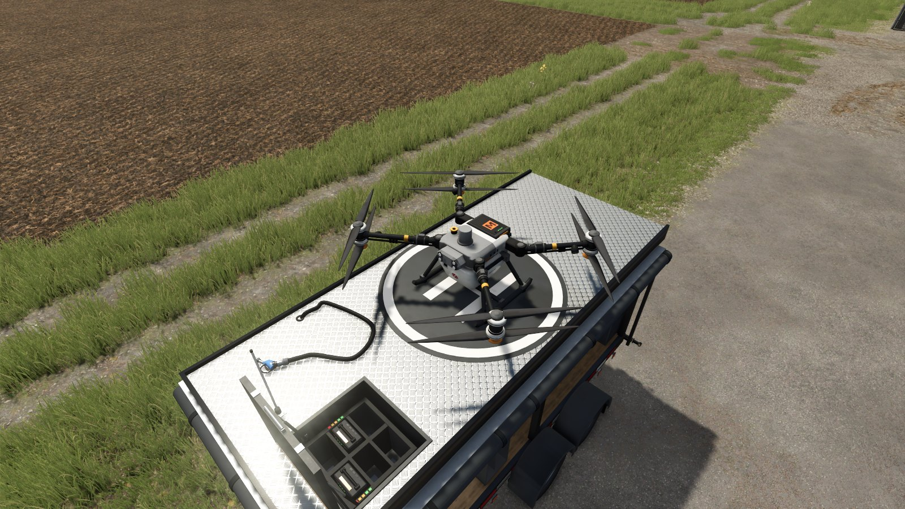
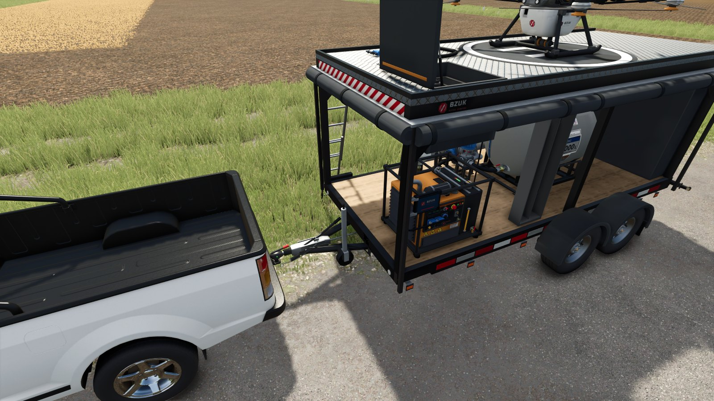
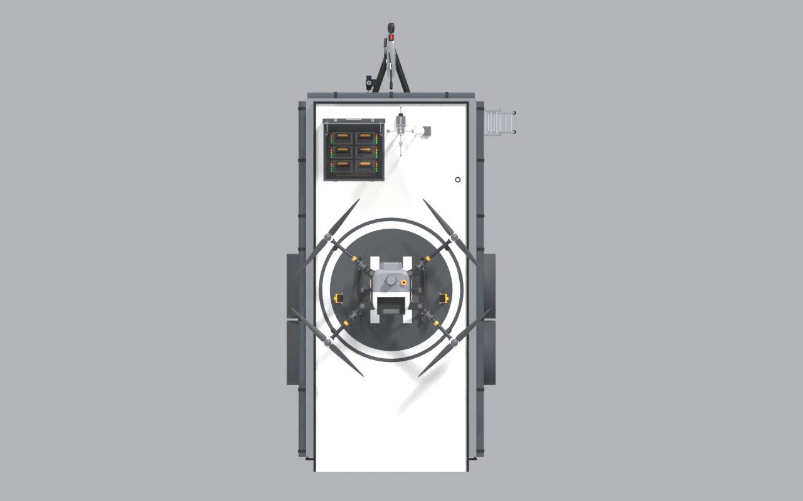

- Dron létá na baterii, která je v něm. Vlek drží **náhradní baterie** v truhle s nabíječkou (Middle/XL) nebo v šachtě (Mini). Vlek se kupuje s 0–6 bateriemi (Middle), 0–4 (Mini), 0–10 (XL); další lze koupit jako zboží v obchodě a vložit klávesou `R`.
- Po přistání se dron doplní a baterie se vymění, pokud je nabití **pod 30 %** (nebo pokud by se další dávka nevešla). Vybitá baterie jde do volného slotu nabíječky, do dronu jde **plně nabitá (≥ 95 %)**.
- Pokud žádná baterie není nabitá, dron **čeká** („čeká na nabití baterie – X %“).
- **Naftová elektrocentrála** nabíjí všechny vybité náhradní baterie najednou. Běží, kdykoli je zapnutá, má naftu a některá náhradní baterie není plná – i se složeným vlekem a když tam nikdo není. **Zapíná se klávesou `B`.** Vypnutá elektrocentrála nenabíjí, ani během mise.
- Spotřeba: asi 0,37 l nafty na jednu baterii M nabitou z 30 na 95 % (asi za 10 minut). Když nafta dojde, mise skončí („v elektrocentrále došla nafta“).
- Baterie v dronu se za letu nenabíjejí. Při skládání vleku baterie přeletí zpět do truhly s nabíječkou, než se víko zavře.
- Dron **bez baterie** nevzlétne.

Plánovač to všechno předem spočítá (čas servisu, čekání na nabití, potřeba nafty vs. nafta v elektrocentrále).

---

## 9. Dosah, relé, antény, tablet

Dron zůstává spojený rádiem. Základní dosah: S 300 m, M 450 m, L 600 m; kruh je vidět na mapě i ve světě. Dosah je navíc omezen tím, co zvládne baterie (cesta tam a zpět s rezervou 30 s).

- **Antény** (Middle/XL, konfigurace v obchodě): základní ×1,0, zesílená ×1,35, velká směrová ×1,7. **RTK GPS** dává o 15 % nižší spotřebu a ve skenovacím režimu menší bezpečnostní rezervu.
- **Relé tyč** (obchod, ~650 $): odneste ji, postavte vzpřímeně na zem, `R` ji rozloží (stativ + teleskopický stožár), `B` ji zapne. Aktivní relé v dosahu vleku prodlouží dosah o svou vzdálenost. **Směrová relé tyč** pokrývá jen výseč 99° před sebou s 1,75× delším dosahem – postavte ji čelem k poli. Tyč lze uložit do držáku na vleku (tam se nabíjí).
- **Tablet** (obchod, ~400 $): držte ho a levým tlačítkem otevřete plánovač nejbližšího rozloženého vleku nebo kufru v dosahu rádia. Bez spojení uvidíte **NO CONNECTION**; opuštění signálu plánovač zavře.

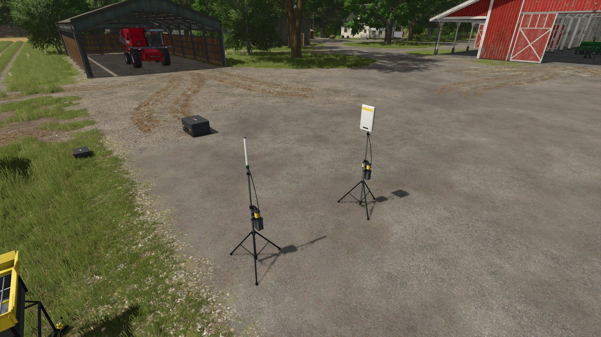
*Ve hře: obě relé tyče, rozložené. Vlevo: všesměrová tyč s teleskopickým stožárem a bílou špičkou. Vpravo: směrová tyč s plochým panelem; její **čelo je strana se širokým žlutým pruhem nahoře** – postavte ji čelem k poli.*

Jak ji postavit: odneste složenou tyč (je to předmět nošený v ruce) na místo **v dosahu rádia vleku**, postavte ji vzpřímeně, vedle ní stiskněte **`R`** (nohy se roztáhnou, stožár se asi za 3 s vysune) a **`B`** (rozsvítí se zelená LED). Složená, vypnutá, převrácená nebo nesená tyč nic nedělá. Plánovač pak vykreslí prodloužený dosah jako druhý kruh (všesměrová) nebo výseč (směrová) v barvách legendy *„dosah relé tyčí“*. Tyče lze uložit na vlek: `R` u držáku.

### 9.1 Parametry relé tyčí

| | **Všesměrová relé tyč** | **Směrová relé tyč** |
|---|---|---|
| Cena (obchod, Vybavení) | 650 $ | 900 $ |
| Silnější varianta (příplatek) | 400 m, +450 $ | 700 m, +450 $ |
| Dosah tyče – standard | 300 m kolem tyče | 525 m ve výseči |
| Tvar pokrytí | kruh | výseč 99° před čelem tyče |
| Natočení | nezáleží | čelem k poli (strana se širokým žlutým pruhem) |

Dosah vleku se prodlouží o vzdálenost aktivního relé od vleku, pokud je relé samo v dosahu rádia vleku. Relé tedy řetězí dosah: postavte ho na okraj stávajícího kruhu a pole za ním je v dosahu.

### 9.2 Jak relé mění dosah (mapa plánovače)

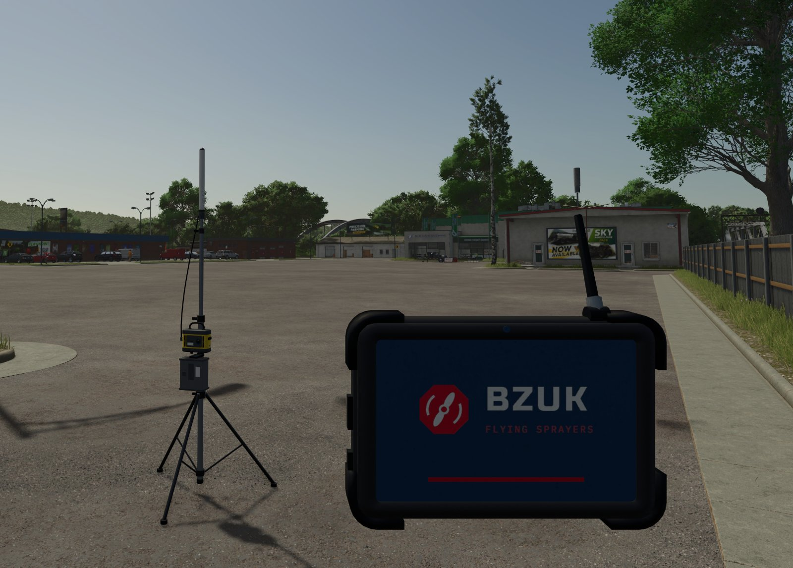
*Všesměrová relé tyč (vlevo) s teleskopickým stožárem a tablet BZUK (vpravo), kterým se plánovač otevírá.*

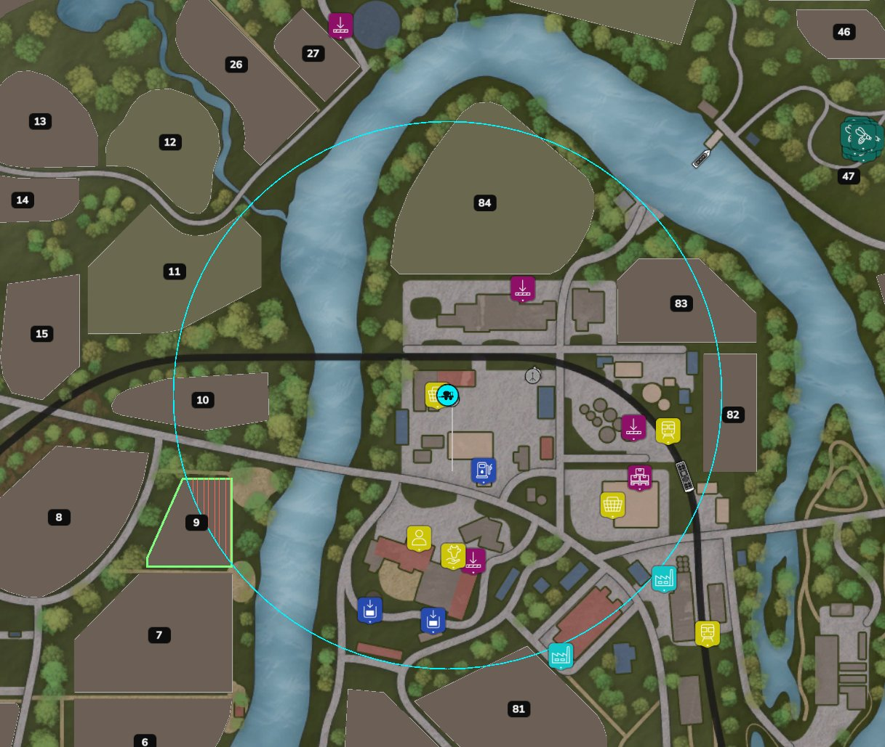
*Bez relé: jen **azurový kruh** základního dosahu kolem vleku. Pole 9 (zeleně označené) leží těsně u okraje, pole dál na západ a na jih už mimo dosah.*

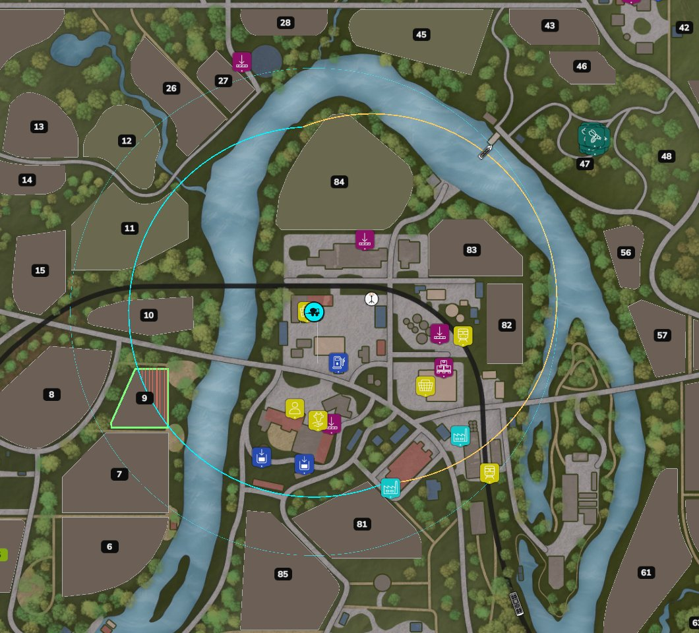
*S všesměrovou relé tyčí: kolem relé (bílá značka tyče) přibyl **žlutý kruh**; pokrytí se tím rozšíří i na pole, která byla původně mimo dosah.*

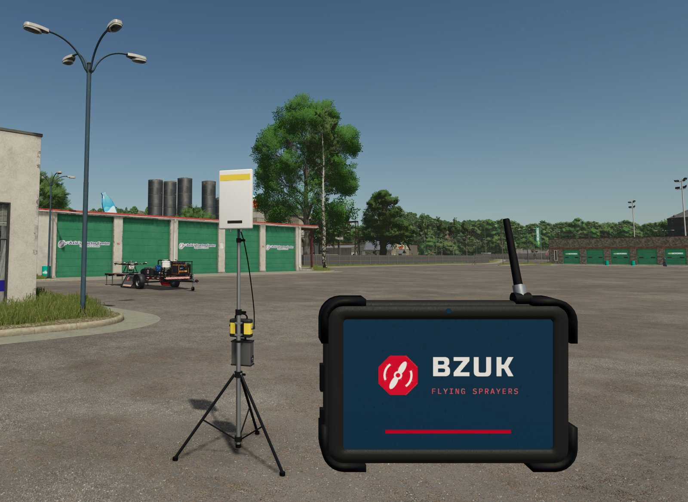
*Směrová relé tyč: plochý panel na stativu. Čelo je strana se **žlutým pruhem nahoře**.*

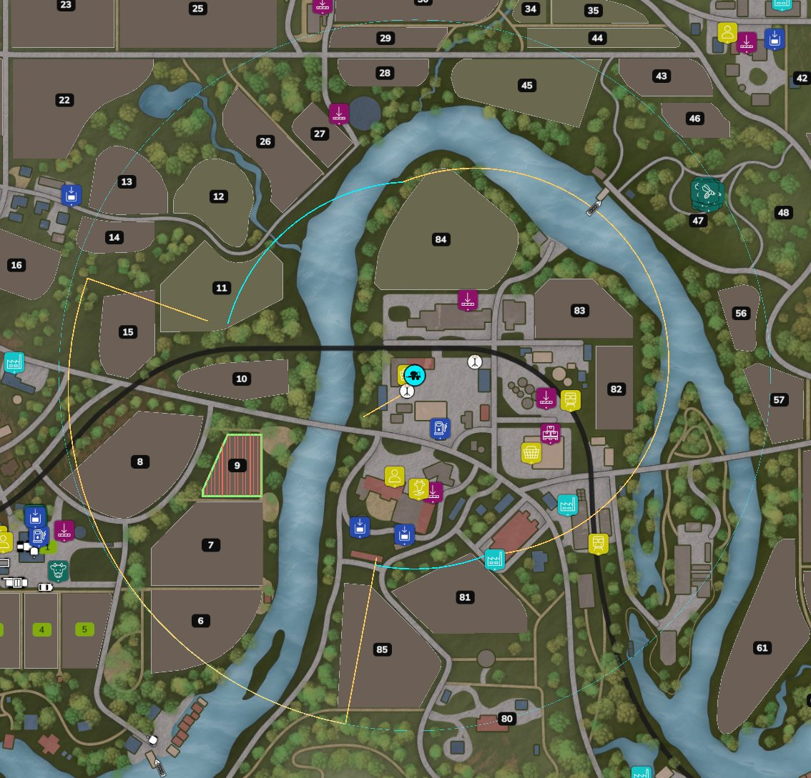
*Se směrovou tyčí: dosah je vidět jako **žlutá výseč** – dlouhá, ale jen v úhlu 99° před čelem tyče. Za ní a po stranách se dosah nezvětší.*

Praktická pravidla: pro pole v jednom směru použijte **směrovou** tyč (dosáhne dál, 525 m místo 300 m, ale jen ve výseči; stojí 900 $), pro pole kolem dokola **všesměrovou** (650 $). Silnější varianta v obchodě zvětší poloměr o třetinu. Aktivní tyč musí být rozložená (`R`) a zapnutá (`B`).

---

## 10. Voda, vápno a logistické vybavení

### 10.1 Vodní pumpa (přenosná)
Naftová pumpa se spojkou **vstup** (modrá) a **výstup** (červená) a dvěma vlastními hadicemi.
- **Vstup** má dva režimy, přepíná se levým kliknutím na spojku vstupu (jen s vypnutým motorem a nepřipojenou hadicí): **nádrž** (spojka Storz k IBC/cisterně/vodnímu vleku) nebo **rybník** (sací koš: odneste konec k vodě a stiskem `R` ho položte pod hladinu).
- **Výstup**: hadice k vodnímu ventilu na vleku (nebo k jakékoli nádrži, která vodu přijímá).
- `B` spustí/zastaví motor; pumpa čerpá 16 l/s. Nafta (15 l) se nalévá z kanystru. Pumpu lze uložit do držáku na vleku.

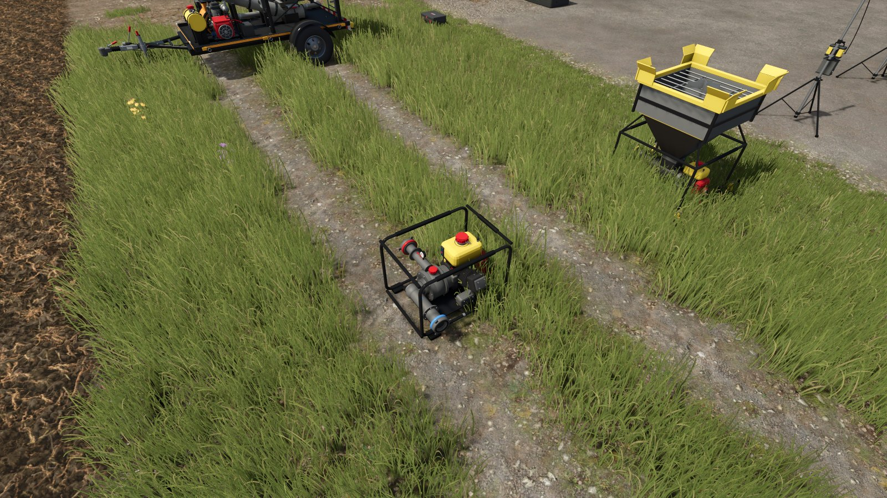
*Ve hře: pumpa. Naftový motor (žlutá nádrž, červený motor) na rámu; **modrá** spojka je vstup, **červená** spojka je výstup.*

### 10.2 Hadice – co kam patří

Se všemi hadicemi se zachází stejně: **`R`** u spojky zvedne volný konec, **`R`** u příslušné zásuvky ho zapojí, **`R`** u zásuvky nebo u spojky znovu ho odpojí (hadice se pustí a smotá).

| Hadice | Začíná u | Končí u | Průtok / délka | Poznámky |
|---|---|---|---|---|
| **Vodní hadice vleku** (Middle, XL) | **Vodní ventil** pod hlavní nádrží (jeden na nádrž; XL má jeden na každou nádrž A/B) | Jakékoli vozidlo nebo nádrž s vodou: IBC, cisterna, vodní vlek, postřikovač | 12 l/s, 12 m | Napouští vlek ze zdroje. Připojená k **prázdné** cizí nádrži do ní vodu z vleku přečerpá. Nádrž s jiným přípravkem odmítne („smíšeno“). |
| **Hadice na vápno vleku** (Middle, XL) | **Přívod vápna** na bílé indukční nádobce (pravá strana, s pákou kohoutu) | **Výstup mlýnku na vápno** nebo **násypky na vápno** (spojka Storz) | 8 l/s | Kohout otevřete levým kliknutím na jeho páku. Motor mlýnku/násypky musí běžet a musí v něm být jemné vápno. |
| **Sací hadice pumpy** (modrá) | **Modrá spojka vstupu** pumpy | Režim **nádrž**: výstup IBC / cisterny / vodního vleku. Režim **rybník**: položte koš do vody (`R` na vodě, hloubka ≥ 15 cm). | 16 l/s, 10 m | Režim se přepíná levým kliknutím na spojku vstupu – jen s vypnutým motorem a odpojenou hadicí. |
| **Výstupní hadice pumpy** (červená) | **Červená spojka výstupu** pumpy | **Vodní ventil vleku** nebo jakákoli nádrž, která vodu přijímá (cisterna, IBC, postřikovač) | 16 l/s, 12 m | Motor musí běžet (`B`). Potřebuje volný ventil do 12 m; jiný přípravek v cílové nádrži ji zablokuje. |
| **Plnicí hadice dronu** | Naviják / smotek na palubě vleku | **Plnicí hrdlo dronu** | Rychlost plnění dronu (1 – 2,5 l/s) | **Automatická.** Při obsluze se hubice přesune k dronu, naplní ho a vrátí se. XL má jeden naviják na dron. |

#### Zapojení 1 – voda: IBC → pumpa → vlek

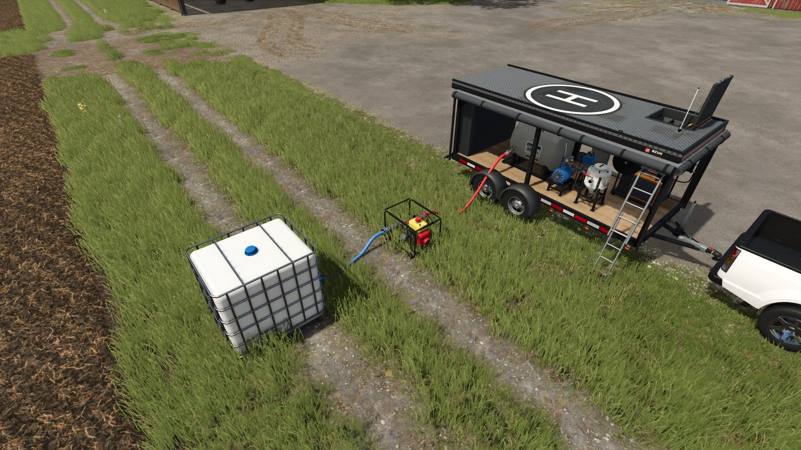
*Ve hře: celý řetězec, nakreslený pohromadě. **IBC s vodou** → **modrá hadice** → **pumpa** → **červená hadice** → **vodní ventil vleku**.*

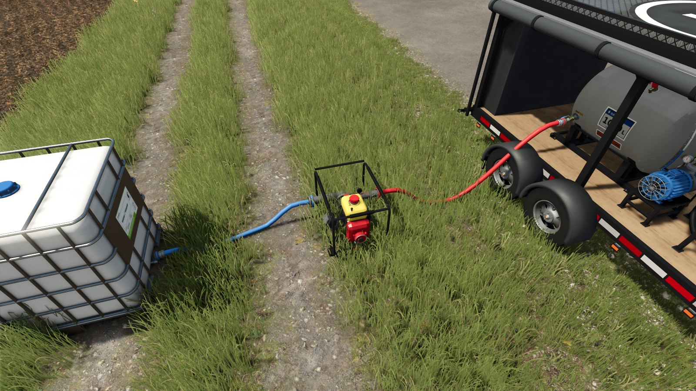
*Pumpa zblízka. Modrá hadice vede od **vstupu** (modrá spojka) k výstupu IBC; červená hadice vychází z **výstupu** (červená spojka) a vede k vleku.*

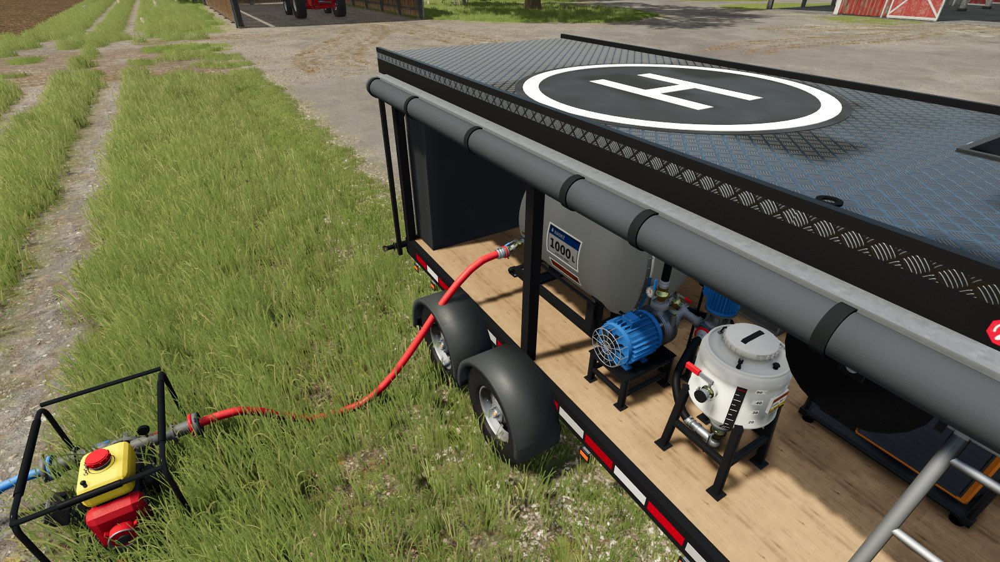
*Červená hadice končí ve **vodním ventilu pod hlavní nádrží** vleku (pravá strana, za nápravami).*

##### Varianta: napuštění z rybníka

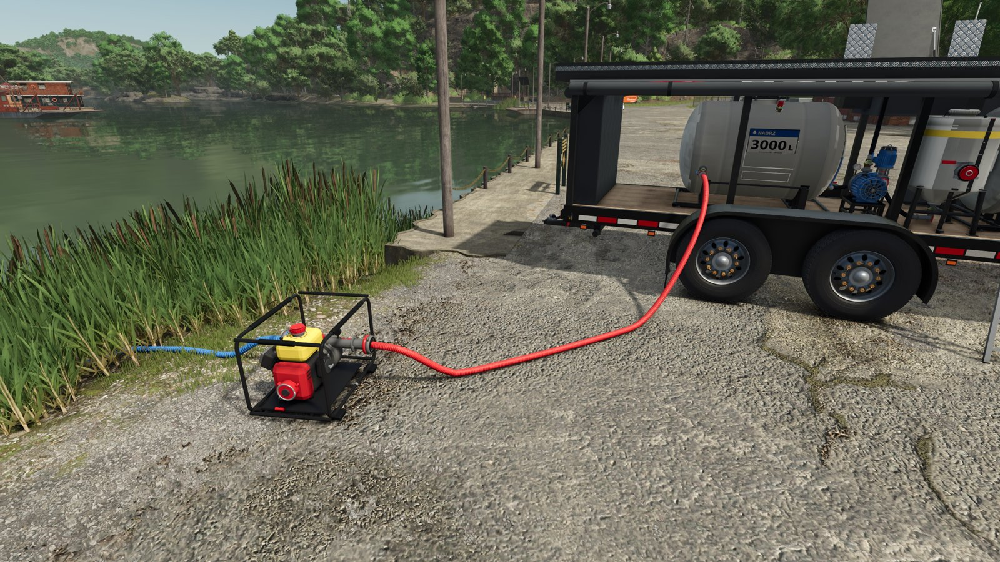
*Pumpa stojí na břehu. **Modrá sací hadice** vede do vody (sací koš pod hladinou, režim vstupu *rybník*), **červená výstupní hadice** vede k vodnímu ventilu pod nádrží vleku (štítek 3000 L).*

##### Varianta: voda z IBC přímo vlekem (bez pumpy)

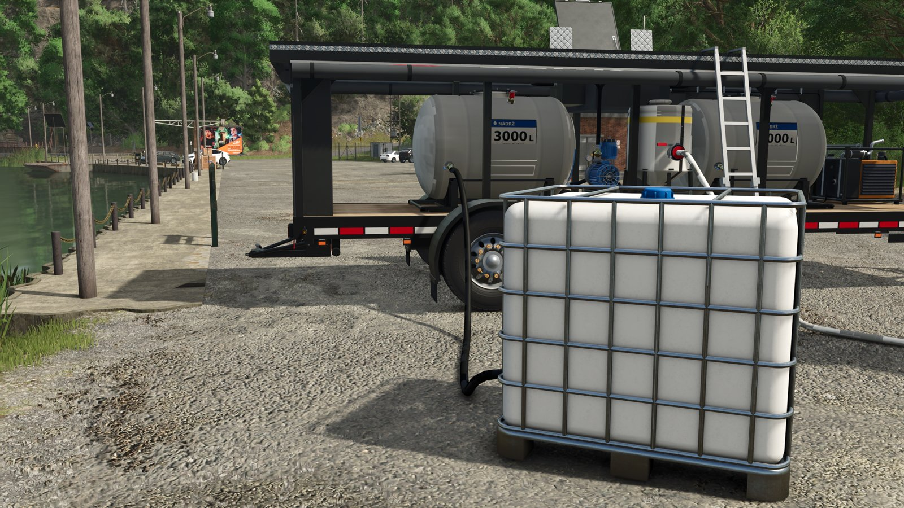
*Černá **vodní hadice vleku** vede z vodního ventilu pod nádrží přímo do IBC. Hodí se na přečerpání z i do IBC (12 l/s).*

##### Varianta: voda z cisterny

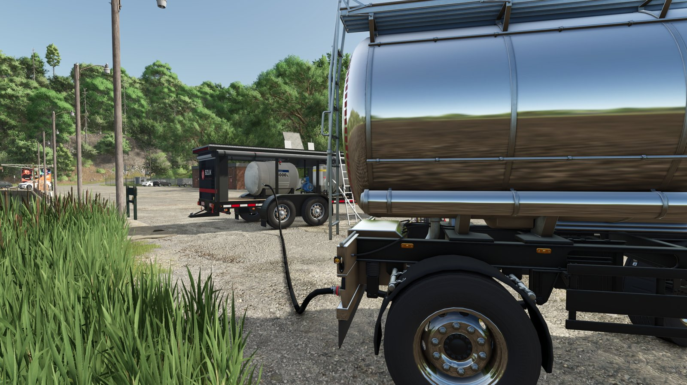
*Totéž s cisternou: hadice vleku je zapojena do výpustě cisterny (vzadu vlek). Cisterna musí obsahovat vodu, jinak zapojení odmítne („smíšeno“).*

Postup: postavte pumpu mezi IBC a vlek (IBC nejvýš asi 10 m od pumpy, ventil do 12 m). Vezměte z pumpy modrou hadici (`R` u spojky vstupu, režim vstupu pumpy *nádrž*) a zapojte ji `R` do IBC; vezměte červenou hadici (`R` u spojky výstupu) a zapojte ji `R` do ventilu vleku; pumpu spusťte `B`. Nádrž vleku se plní rychlostí až 16 l/s.

#### Zapojení 2 – vápno z násypky: násypka → vlek

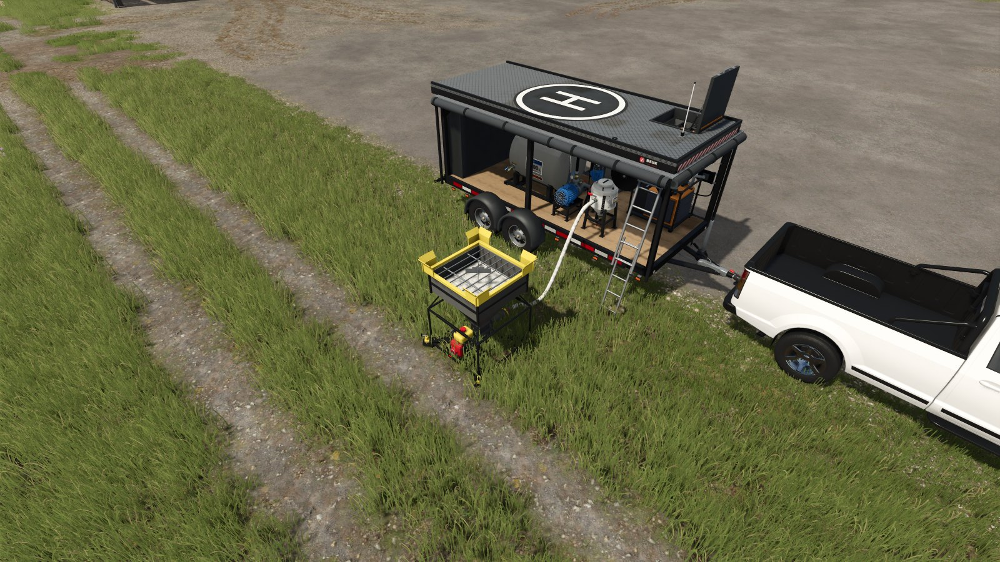
*Ve hře: **násypka na vápno** stojí vedle vleku; **bílá hadice** vede od výstupu násypky (spojka Storz na jejím boku) k **přívodu vápna na bílé indukční nádobce**.*

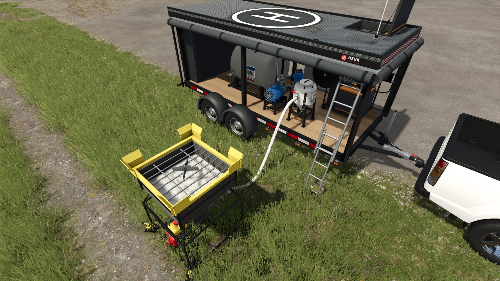
*Zblízka: výstup násypky na straně k vleku a hadice stoupající na palubu.*

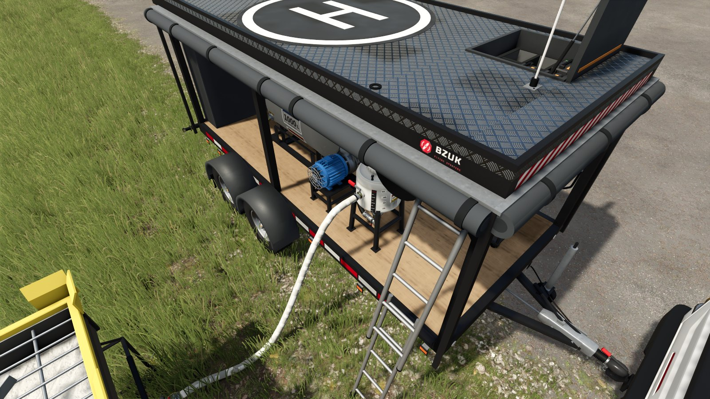
*Hadice zapojená do **přívodu vápna na indukční nádobce** (vlek, pravá strana – stejná jako žebřík). Páka kohoutu přívodu musí být otevřená.*

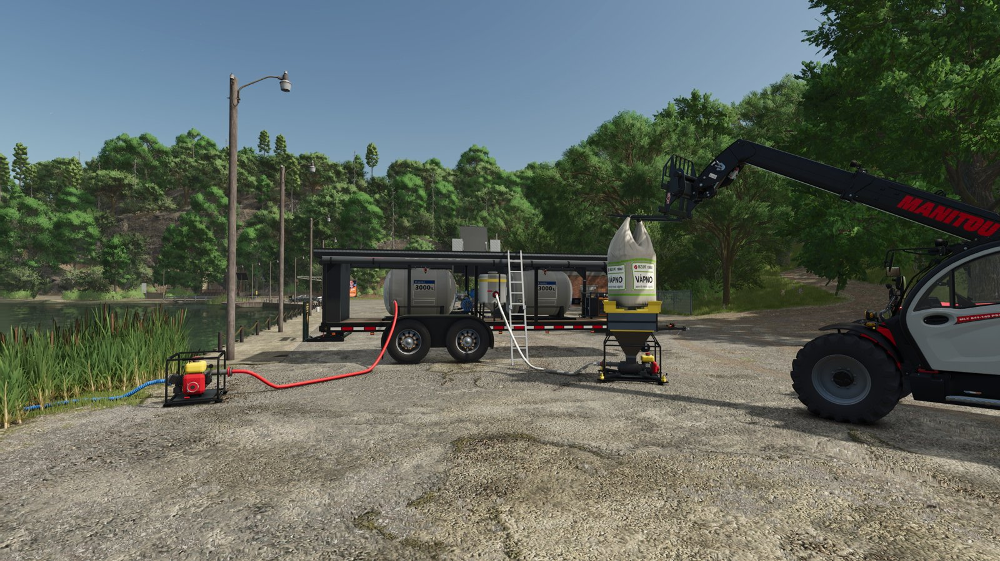
*Celé stanoviště pohromadě: vlevo pumpa s vodou z rybníka (červená hadice), vpravo násypka s **big bagem vápna** vloženým čelním nakladačem; **bílá hadice** vede od násypky k přívodu vápna. Voda i vápno plní vlek zároveň.*

Postup: nasypte vápno do násypky (pytle po 50 l, nebo big bag na její stolici s vysunutými opěrami), motor spusťte `B`. Vezměte hadici na vápno vleku u přívodu (`R`), zapojte ji do výstupu násypky (`R`) a levým kliknutím na páku otevřete kohout. Vápno teče do indukční nádobky rychlostí 8 l/s.

#### Zapojení 3 – vápno z vozíku s mlýnkem: mlýnek → vlek

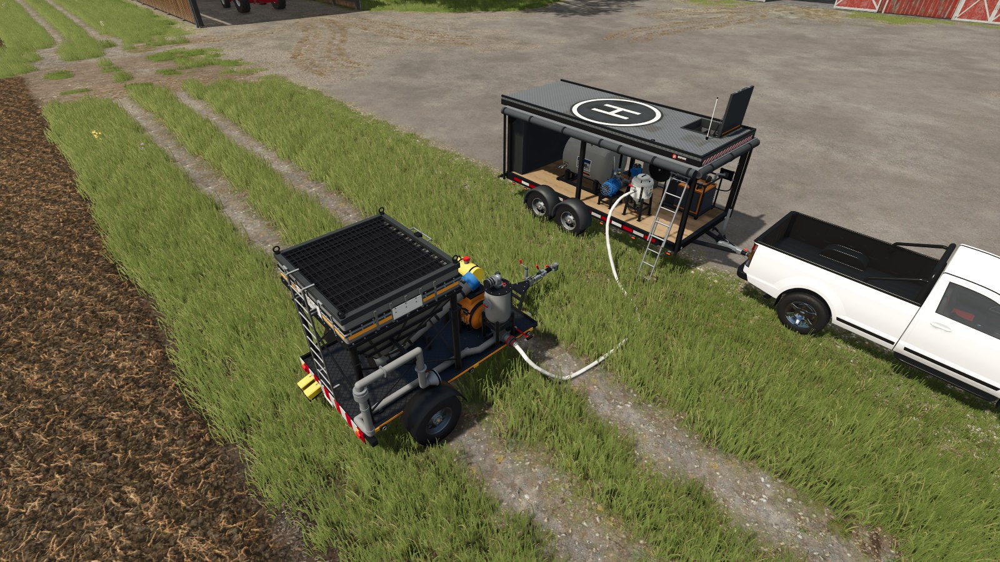
*Ve hře: **vozík s mlýnkem na vápno** zaparkovaný vedle servisního vleku; bílá hadice vede od výstupu mlýnku k přívodu vápna.*

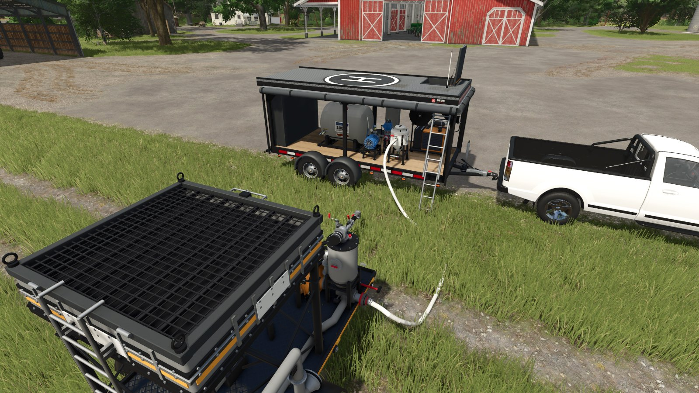
*Zblízka: výstup mlýnku (válcový zásobník se spojkou Storz) na straně k vleku.*

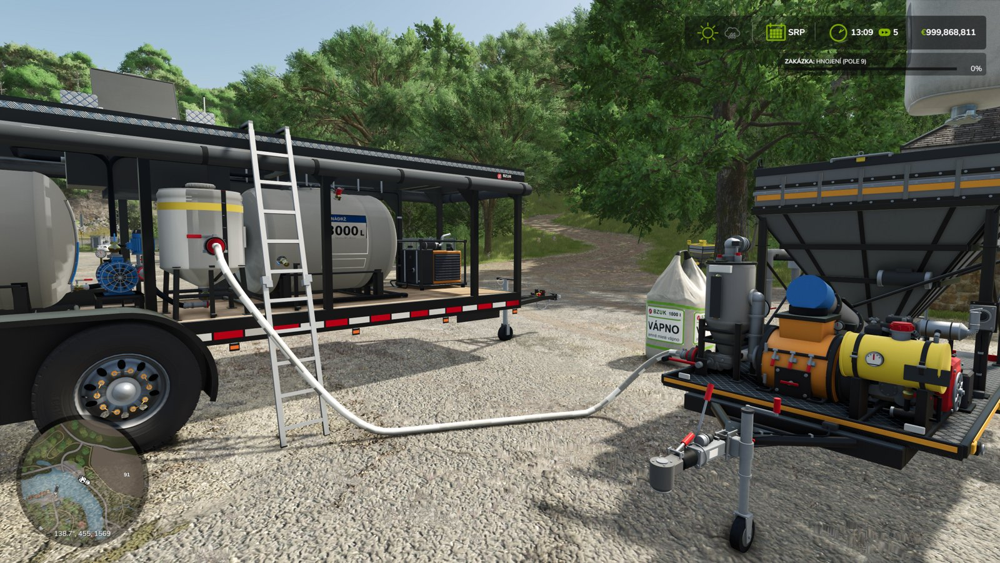
*Hotové zapojení z boku: **bílá hadice** od výstupu mlýnku (vpravo) k bílému **přívodu vápna na indukční nádobce** vleku (vlevo, vedle žebříku). Za mlýnkem je vidět big bag s vápnem.*

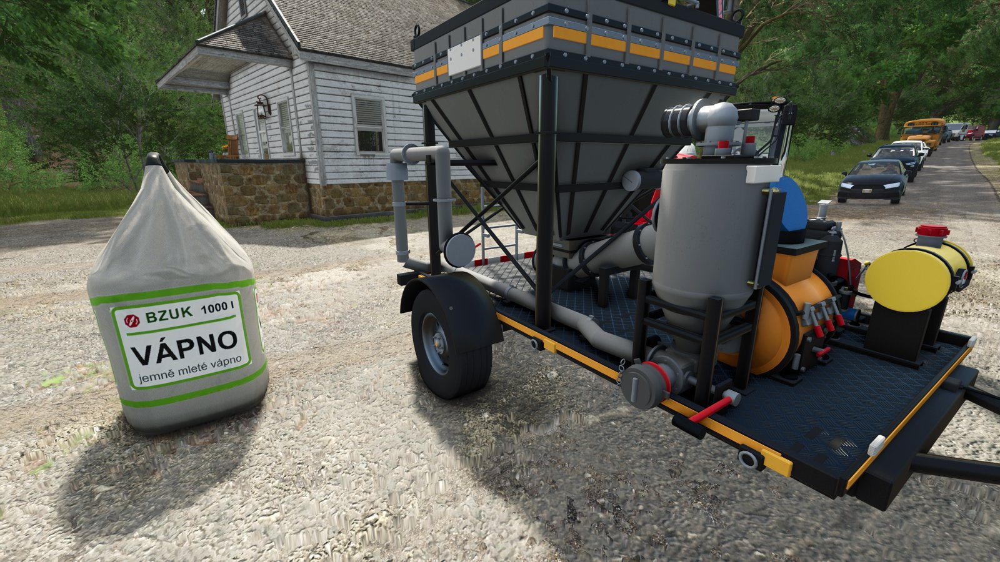
*Druhá možnost: páku ventilu mlýnku dejte na **výsypnou rouru** – jemné vápno teče do **big bagu** (štítek *VÁPNO – jemně mleté vápno*, 1 000 l). Big bag pak odvezete a vložíte do násypky (Zapojení 2).*

Postup: hrubé vápno se sype do zásobníku nahoře na mlýnku; spusťte motor (`B`); páku ventilu nastavte na **hadici**; hadici na vápno vleku zapojte do výstupu mlýnku. (Táž páka nastavená na **výsypnou rouru** plní místo toho big bag – viz 10.3.)

#### Zapojení 4 – herbicid v IBC vedle vleku

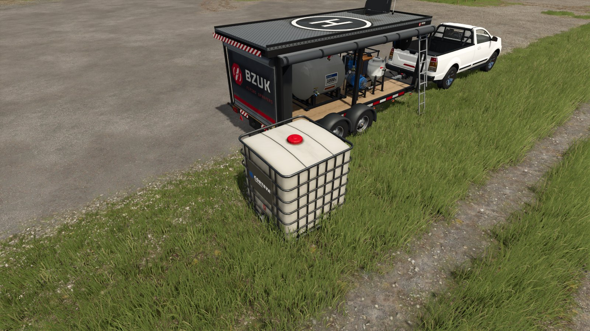
*Ve hře: vanilla **IBC s herbicidem** zaparkovaný do 6 m od vleku.*

Nádrž vleku lze do takového IBC přečerpat **`Alt+2`** (IBC musí být do 6 m; dalším stiskem zastavit) – hodí se na vyprázdnění zbylého přípravku. Herbicid se do vleku dostane buď hotový z plnicí stanice, nebo jako **koncentrát**: 20litrové kanystry s herbicidem uložte do skříně nebo je nalijte do indukční nádobky a hlavní nádrž naplňte vodou (viz kapitola 6).

#### Stručný přehled – typická zapojení
- **Napuštění z rybníka:** sací hadice pumpy → koš v rybníku (režim *rybník*); výstupní hadice pumpy → vodní ventil vleku; pumpu spusťte `B`.
- **Napuštění z IBC:** vstup v režimu *nádrž* → výstup IBC; výstup → ventil vleku. (Nebo pumpu vynechte a použijte vodní hadici vleku od jeho ventilu k IBC.)
- **Vyprázdnění vleku do cisterny:** vodní hadice vleku od ventilu k prázdné cisterně.
- **Vápno:** výstup mlýnku nebo násypky → hadice na vápno vleku → přívod vápna na indukční nádobce; otevřete kohout, spusťte motor.

### 10.3 Vápnění
Vápnění je produkt míchačky: jemné vápno (`Jemně mleté vápno`) je koncentrát 20 %, dron stříká `LIME`. Funguje na holé půdě, strništi nebo čerstvě osetých polích, a jen když je vápnění v nastavení hry vyžadováno.

Postup pro jemné vápno:
1. **Vozík s mlýnkem na vápno** (obchod, ~16 500 $; zapojte ho za XL nebo za jakýkoli traktor): hrubé vápno z vanilla vleku nebo big bagu se sype do jeho zásobníku; naftový motor pohání šnek a kladivový mlýn (6 l/s). `B` pěšky u rozvaděče (nebo ve vleku) spustí motor. Jemné vápno jde do zásobníku 150 l.
2. **Páka ventilu**: vodorovně = **hadice**, svisle = **výsypná roura**. Přepíná se levým kliknutím na páku, nebo `Y` z vozidla. Režim hadice potřebuje hadici k přívodu vápna na vleku (ventil otevřený); režim roury potřebuje rouru (`O` přepíná přeprava → vedle → za) a stojící vozík – plní **big bag** pod rourou.
3. **Násypka na vápno** (obchod, ~2 400 $): přenosná násypka s vlastním motorem. Plní se pytli po 50 l (nakloněnými nad nálevku) nebo big bagem postaveným na její stolici (opěry musí být nejdřív vysunuty – levé kliknutí na nohu). Hadicí podává vápno do přívodu vápna na vleku.

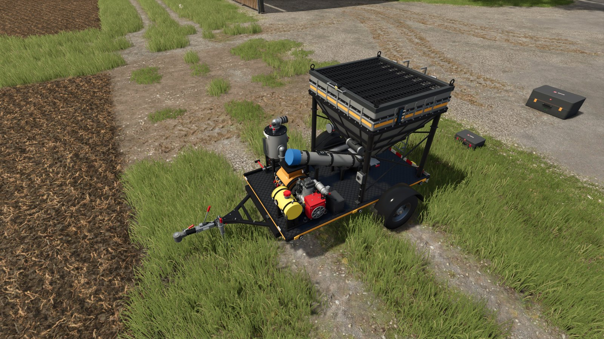
*Ve hře: vozík s mlýnkem na vápno: černý zásobník nahoře přijímá hrubé vápno, pod ním šnek a mlýn s naftovým motorem (žlutá nádrž) a válcový zásobník na jemné vápno se Storz výstupem na boku.*

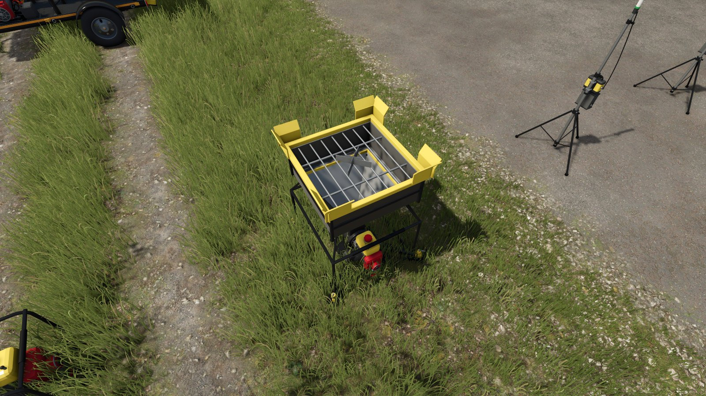
*Ve hře: násypka na vápno se žlutou stolicí; pytle nebo big bag se pokládají na rošt a jemné vápno odchází Storz spojkou na boku hadicí na vápno do vleku.*

### 10.4 Shrnutí okruhu přípravku
Hrubé vápno → mlýnek → (hadice → vlek) nebo (big bag → násypka → hadice → vlek) → nádrž na koncentrát → smíchá se s vodou na 20 % → dron.

| Co chcete | Zdroj | Cesta | Kapitola / obrázky |
|---|---|---|---|
| Napustit vodu z rybníka | rybník | koš → pumpa (režim *rybník*) → vlek | Zapojení 1, varianta rybník |
| Napustit vodu z IBC | IBC | IBC → pumpa → vlek, nebo hadice vleku přímo | Zapojení 1 |
| Napustit vodu z cisterny | cisterna | hadice vleku z ventilu do výpustě cisterny | Zapojení 1, varianta cisterna |
| Vápno rovnou do vleku | hrubé vápno | zásobník mlýnku → mlýnek (páka na **hadici**) → hadice → přívod vápna | Zapojení 3 |
| Semlít jemné vápno do big bagu | hrubé vápno | mlýnek (páka na **výsypnou rouru**) → big bag | Zapojení 3, 10.3 |
| Vápno z big bagu / pytlů | big bag, pytle | násypka → hadice → přívod vápna | Zapojení 2 |
| Herbicid | IBC, kanystry | hotový z plnicí stanice, nebo koncentrát + voda | Zapojení 4, kapitola 6 |

---

## 11. Skenování, bodová aplikace a odběr půdních vzorků

### 11.1 Kufr se skenovacím dronem (přenosný průzkumný dron „C“)
Kufr se skenovacím dronem a dvěma bateriemi (~9 750 $). `R` otevře víko, vedle kufru se rozloží přistávací plošina, pak se dron rozloží. Zavřít jde jen s dronem doma a zastavenými vrtulemi. Ovládá se z **tabletu** (nebo z plánovače v dosahu). Skenuje **jen vaše vlastní pole** a nikdy nestříká; dron nevzlétá z kufru samotného.
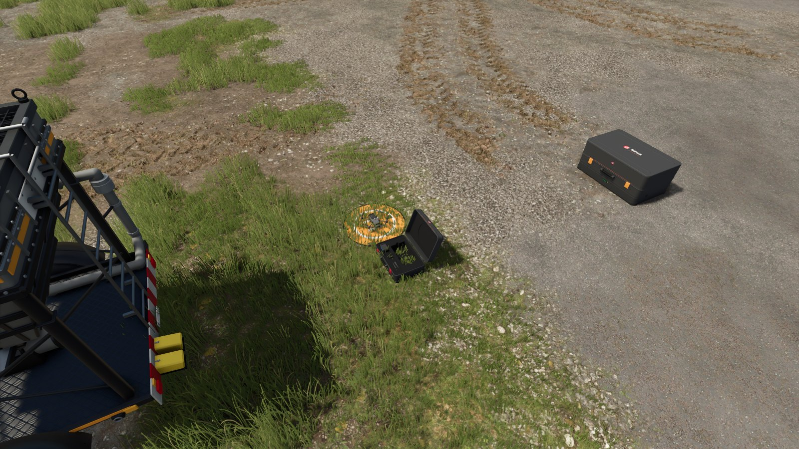
*Ve hře: kufr se skenovacím dronem s otevřeným víkem a vedle něj rozvinutá kulatá přistávací plošina (druhý, zavřený černý kufr v pozadí je kufr se vzorkovacím dronem).*

- **Nabíjení**: baterie se nabíjejí do 15 m od farmářské budovy (dům, dílna, silo, kůlna s vnitřním prostorem, nabíjecí stanice) nebo u **běžící elektrocentrály vleku**.
- Dosah je kratší: 500 m (kufr se skenovacím dronem).
- Sken potřebuje denní světlo, žádný déšť a vítr pod 12 m/s. Možnosti velikosti buňky: nízko (buňky 5 m, výška 8 m), středně (10 m / 15 m), vysoko (20 m / 30 m).
- Naskenovaná buňka zaznamená plevel (i neviditelnou ranou fázi), vitalitu porostu, růstovou fázi, kameny. Vápno a pH sken **nečte**.

### 11.2 Mapa skenu
Naskenované buňky se v plánovači zobrazují barevně podle vrstvy (plevel, vápno, hnojení/vitalita, zralost, kameny, pokrytí a s Precision Farming dusík a pH). Buňky starší než 48 herních hodin jsou vybledlé. Po ošetření se buňky zbarví modře („ošetřeno po skenu“).

### 11.3 Aplikace podle skenu (bodový postřik)
V plánovači nastavte **Aplikace: podle skenu**. Dron pak ošetřuje **jen** vybrané buňky (s bezpečnostní rezervou 6 m, s RTK 1,5 m): herbicid tam, kde je plevel, vápno tam, kde chybí, hnojivo tam, kde je nízká hladina. S Precision Farming vápno používá mapu pH (jen na buňkách, kde farma odebrala vzorky) a hnojivo cílovou hodnotu dusíku plodiny. Plánovač porovnává *celé pole* s *podle skenu* (litry, minuty, úspora).

### 11.4 Kufr se vzorkovacím dronem (odběr půdních vzorků AIRASI, „P“, vyžaduje Precision Farming)
Kufr (~14 600 $) se vzorkovacím dronem, dvěma bateriemi a **24místnou bedničkou na vzorky**. Dron letí do každého bodu mřížky (rozestup podle hustoty odběru v PF), přistane, zatlačí čtyřstupňovou sondu do půdy, 3 s vydrží a v jednom letu odnese dva vzorky do bedničky. Vzorky odešlete **levým kliknutím na bedničku** (nebo tlačítkem „Odeslat vzorky“ / `End` v plánovači); laboratoř Precision Farming je rozboruje a účtuje za každý vzorek. Plná bednička blokuje další mise.

---

## 12. Počasí a limity

| Podmínka | Postřik | Skenování | Odběr vzorků |
|---|---|---|---|
| Déšť | nelze letět | nelze letět | nelze letět |
| Limit větru | S 5 / M 6 / L 7 m/s | 12 m/s | 10 m/s |
| Tma | povoleno | nepovoleno | povoleno |

Plánovač ukazuje *„Počasí: vítr 3,1 m/s (limit 6 m/s) – lze letět / příliš fouká / prší / tma“*. Pokud se podmínky zhorší **za** letu, dron se vrátí domů a oznámí proč. Vlek se během mise nesmí pohnout: pokud se pohne (rychlost nad limit, nebo o víc než pár metrů), mise se přeruší („vlek se rozjel“).

Další limity: překážky vyšší než limit výšky přeletu blokují trasu; pole se přijímají jen tehdy, když je vaše farma vlastní nebo na ně má zakázku; zakázka se vybírá vcelku a je možná jen se správným přípravkem (hnojení = hnojivo, herbicidní mise = herbicid).

---

## 13. Hlášky a řešení potíží

| Hláška / příznak | Příčina a oprava |
|---|---|
| „Vlek je složený – nejdřív ho rozlož“ | Stiskněte `X`. |
| Nejde rozložit | Náklon vleku přes 5° – přejeďte na rovný terén. |
| „Vrtule dronu ještě dobíhají – složit jde, až se zastaví“ při skládání | Počkejte, až se zastaví a vrátí do klidové polohy. |
| „Nejdřív přendej dron do bedny (R u bedny)“ (Mini) | `R` u plošiny s prázdnýma rukama. |
| „Dron nemá baterii, nemůže vzlétnout“ | Vložte baterii do dronu nebo do truhly s nabíječkou. |
| Dron čeká na plošině | Žádná náhradní baterie ≥ 95 % – zapněte **elektrocentrálu**, zkontrolujte naftu. |
| „V elektrocentrále došla nafta“ | Dolijte naftu z kanystru. |
| „Chybí koncentrát“ / „Chybí voda“ | Doplňte chybějící nádrž (kapitola 6). |
| „Vlek stojí mimo letovou plochu“ / „Letová plocha nespojuje vlek s polem“ | Upravte nebo smažte letovou plochu (`X`, `Backspace`). |
| Pole nejde vybrat | Mimo dosah, není vaše, nebo zakázka potřebuje jiný přípravek. |
| „NO CONNECTION“ | Mimo dosah rádia – přibližte se nebo postavte relé tyč. |
| Dron nevzlétne v dešti/větru | Viz kapitola 12. |
| Stisk `B` nic nedělá | Klávesu `B` může mít přiřazenou jiný mod (např. ruční nářadí); předefinujte akci tohoto modu. |

---

## 14. Známá omezení (stav této verze)

- Ovládání plánovače gamepadem není ověřeno (jen myš a klávesnice).
- Multiplayer je podporován na papíře, ale otestován jen částečně; mod je testován hlavně v singleplayeru.
- Několik novějších funkcí bylo otestováno **jen přes ladicí příkazy a offline testy**, ne plnohodnotnou ruční hrou: přenosné kufry se skenovacím a vzorkovacím dronem, drony jako předměty nošené v ruce, big bag na vápno / stolice násypky a opěry, směrová relé tyč, vrstvy dusíku/pH z Precision Farming, přepínání režimu vstupu pumpy a nová obrazovka plánovače s gamepadem.
- Zvuky byly ověřeny podle herního logu, ne poslechem.
- Prahové hodnoty skutečného počasí (vítr/déšť) byly ověřeny vynucenými hodnotami.
- Rozložení na nakloněném vleku záměrně nefunguje; vleky nemají vyrovnávací opěry.

---

*Příloha – rendery tří vleků shora*

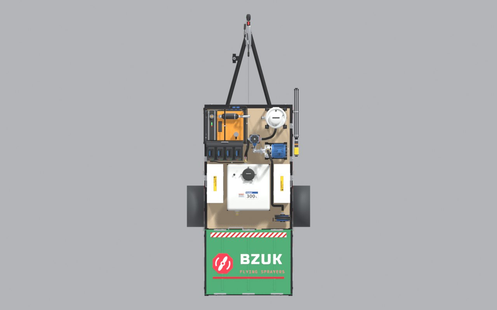
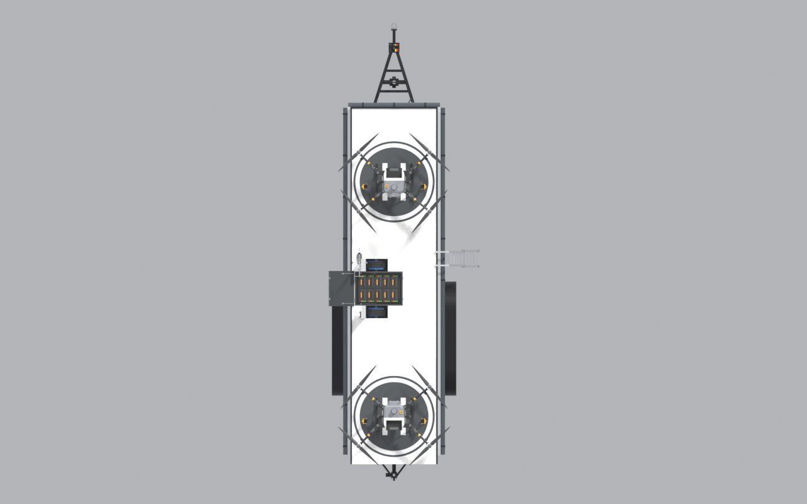
