# Spray Drone Service Trailer – User Manual

---

## 1. What it is

A service trailer for agricultural spray drones. You park the trailer at a field, unfold it, and plan the flight on a map. The drone then sprays (or limes, or scans) the field **on its own**: it flies the rows, comes back to the trailer when the tank or battery runs low, is refilled, swaps its battery for a charged one, and continues until the field is done.

What the system consists of:

| Part | What it does |
|---|---|
| **Trailer** (Mini / Middle / XL) | Carries the product tank, the diesel generator with battery charger, the concentrate mixer, the canister storage and the landing pad(s) for the drone(s). |
| **Spray drone** (S / M / L) | Flies the route and sprays. Bought separately and placed on the pad. |
| **Flight planner** | Full-screen map: pick a field, see the route, range and warnings, start the flight. |
| **Batteries + generator** | The drone flies on batteries; the diesel generator on the trailer charges the spare ones. |
| **Mixer + concentrate tank** | Lets you carry water plus a small amount of concentrate instead of tons of ready-made product. |
| **Relay pole, antennas, tablet** | Extend the radio range and let you open the planner away from the trailer. |
| **Water pump, lime mill, lime hopper, big bag** | Extra logistics: fill the tank from a pond or IBC, grind and feed lime. |
| **Scan case / sampler case** | Portable scouting drones: a field scan map, and soil sampling (Precision Farming). |

---

## 2. The three trailers

### 2.1 Middle (all-round)

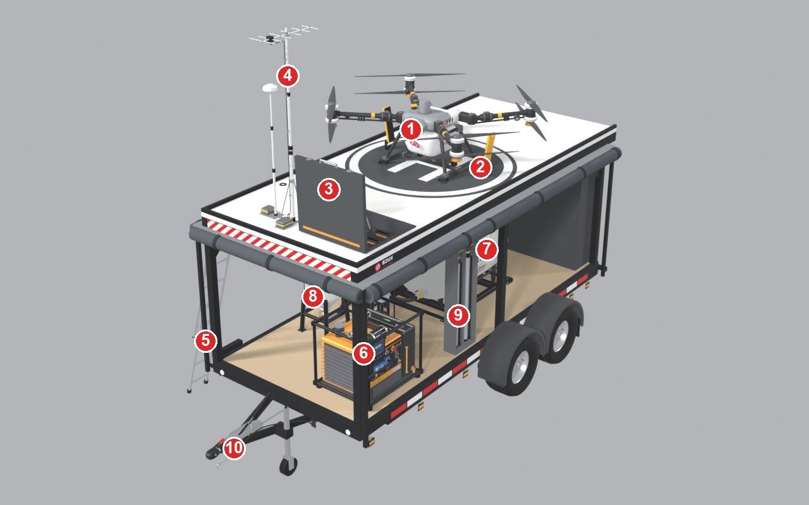

1. Drone on the landing pad (one drone: S, M or L)
2. Landing pad (heliport "H")
3. Battery charger chest (lid opens when the trailer is unfolded; slots for spare batteries)
4. Antenna mast and RTK GPS receiver (optional, from the shop configuration)
5. Ladder (folds down on the right side)
6. Diesel generator + charger (orange cabinet)
7. Main tank (800 / 1,000 / 1,500 / 3,000 / 5,000 l)
8. Induction (concentrate) tank with the mixer
9. Canister cabinet (48 slots of 20 l, roller door at the rear)
10. Drawbar (hitch)

### 2.2 XL (two drones)

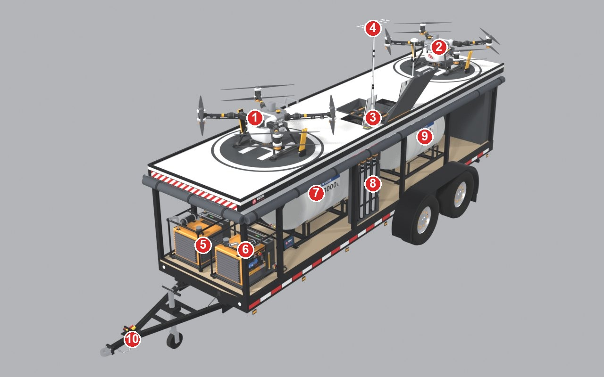

1. Drone 1 on pad 1
2. Drone 2 on pad 2
3. Battery charger chest between the pads
4. Antenna mast
5. Generator A
6. Generator B
7. Tank A (3,000 or 5,000 l)
8. Canister cabinet (48 slots, between the tanks)
9. Tank B
10. Drawbar (tractor eye by default; a car-type ball hitch is an option)

The XL carries **two drones that work together**: the planner controls both at once and splits the route between them. Each drone has its own hose and reel. Both pads must hold drones of the **same size**. The XL also has a rear ball hitch for the lime mill trailer.

### 2.3 Mini (compact, crate)

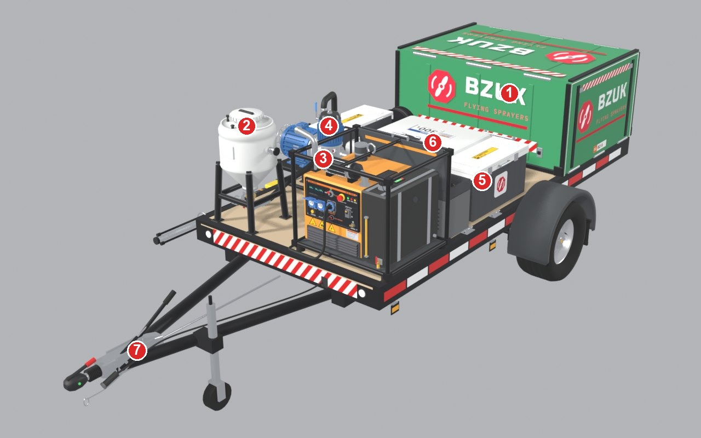

1. Drone crate (green box; the drone stays inside while the trailer is folded)
2. Induction (concentrate) tank
3. Generator + charger
4. Pump and mixer (blue)
5. Canister boxes (two boxes, 4 canisters each)
6. 300 l tank
7. Drawbar

Mini specifics: a single small drone (S), 300 l tank, 6 m working width. The crate unfolds into a platform standing on legs. **The drone is not moved by the animation**: you carry it between the crate and the platform yourself (`R` with empty hands at the other place). A Mini with the drone on the platform cannot be folded ("Move the drone into the crate first").

### 2.4 Comparison

| | Mini | Middle | XL |
|---|---|---|---|
| Drones | 1 (S) | 1 (S / M / L) | 2 (S / M / L, both equal) |
| Tank | 300 l | 800 – 5,000 l | 6,000 or 10,000 l (2 tanks) |
| Working width | 6 m | 6 / 9 / 11 m | 2 × 6 / 9 / 11 m |
| Spare batteries | 0 – 4 | 0 – 6 | 0 – 10 |
| Ladder | – | yes (right side) | yes (right side) |
| Canister storage | 2 × 4 slots | 48 slots | 48 slots |
| Antenna and RTK options | – | yes | yes |
| Rear hitch for mill trailer | – | – | yes |
| Approx. price (trailer only) | $3,900 | $6,100 | $48,000 (with drones) |

(Prices: see the in-game shop; they can differ in your game.)

---

## 3. The drones

| | **S** | **M** | **L** |
|---|---|---|---|
| Model class | DJI T25-like | DJI T50-like | DJI T100-like |
| Tank | 20 l | 40 l | 75 l |
| Working width | 6 m | 9 m | 11 m |
| Flight time, full tank | ~9 min | ~8 min | ~6 min |
| Radio range (base) | 300 m | 450 m | 600 m |
| Refill speed | 1 l/s | 1.5 l/s | 2.5 l/s |
| Wind limit for spraying | 5 m/s | 6 m/s | 7 m/s |
| Price (BZUK shop) | $7,000 | $12,000 | $22,000 |

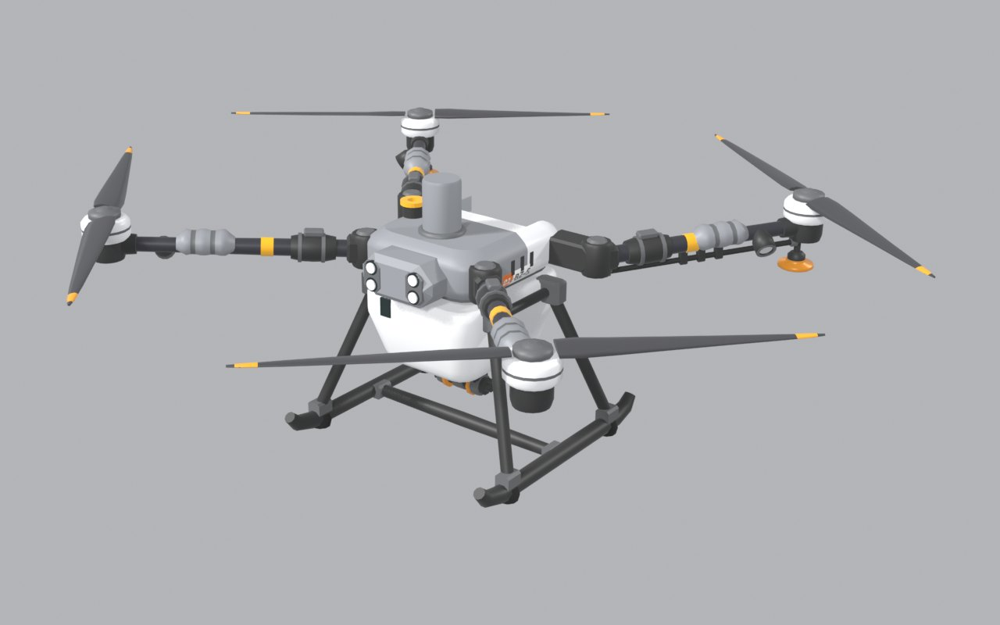
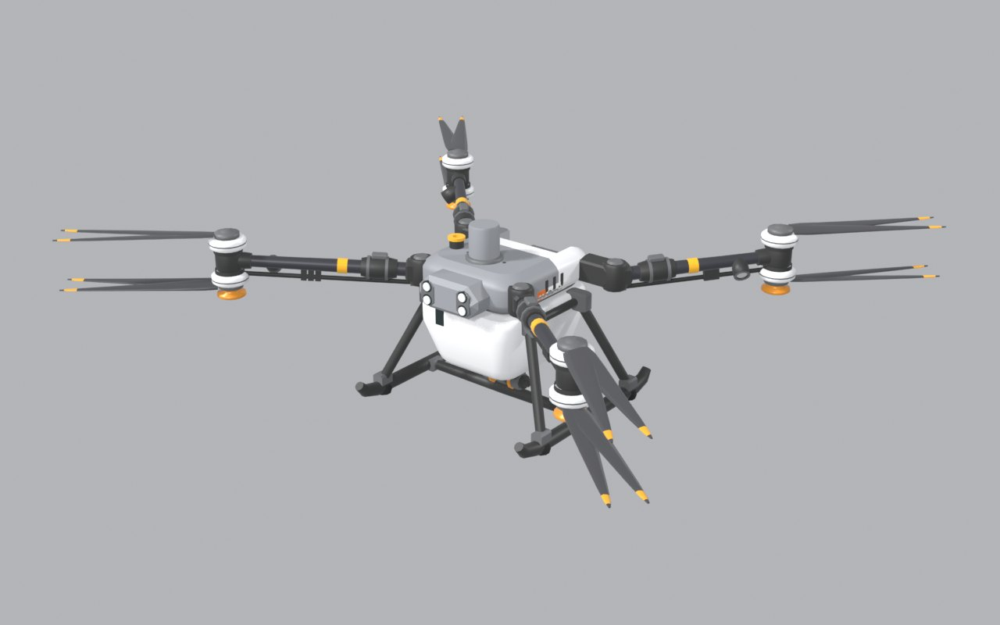
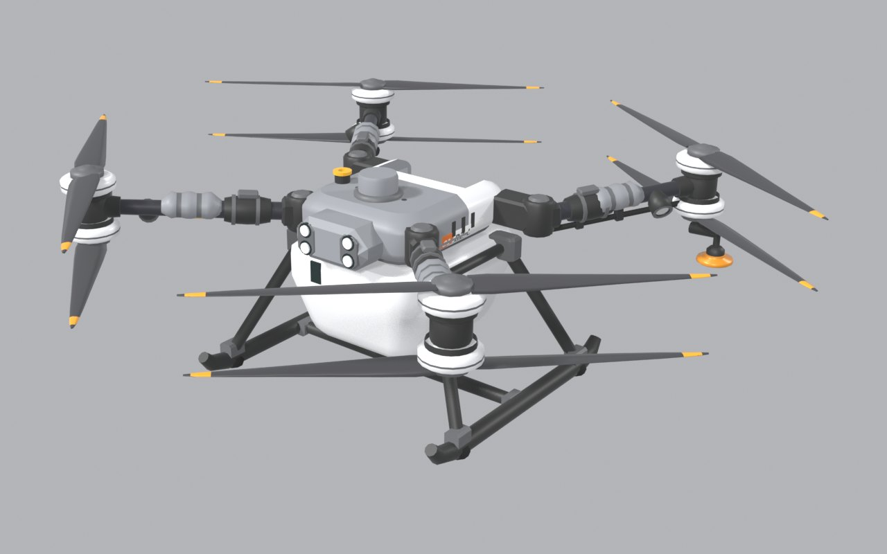

The drone is a **hand-carried object** sold in the BZUK shop (category Drones / Equipment). Pick it up and press **`R`** next to the landing pad to mount it. To take it off, press `R` with empty hands at an occupied pad (not during a mission; an unfolded drone folds first). The drone keeps its tank content. Changing the drone size is only possible with the trailer folded.

Navigation lights (like real agricultural drones): front-left **red**, front-right **green**, rear **white, blinking**. They are lit only while the drone is running.

Other drones (portable cases, see chapter 11): **C** (scan drone), **P** (soil sampler).

---

## 4. Quick start (spraying a field)

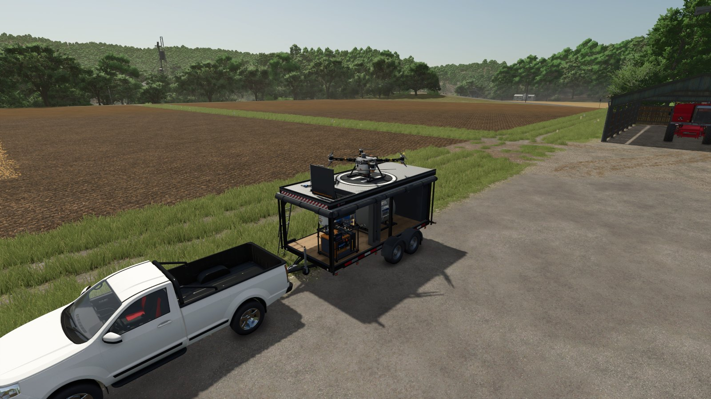
*In game: a Middle trailer behind a pickup, unfolded next to the field. The open lid on the deck is the battery charger chest.*

1. **Drive** to the field with a tractor or pickup. Park on level ground – the trailer can only unfold when it stands with **no more than 5° tilt** (shown in the help panel while folded).
2. **Fuel** the generator (diesel canister: tilt it over the generator filler neck, or press `R` at it). Switch the generator on: **`B`** (standing at the exhaust, or from the vehicle).
3. **Unfold** the trailer: **`X`** (from the tractor or the trailer). The charger lid opens, the ladder drops, the drone unfolds arms and then blades.
4. **Fill the tank** (see chapter 6): ready-made fertilizer / herbicide, **or** water + concentrate.
5. **Open the planner**: climb in and press **`Alt+7`**, or left-click the display on the trailer, or hold the **tablet** and left-click.
6. **Click a field** (your own, or an accepted fertilizing/herbicide contract) on the map. The route appears. Check the warnings on the plan card.
7. **Start**: `Enter` in the planner or **`Alt+8`**.
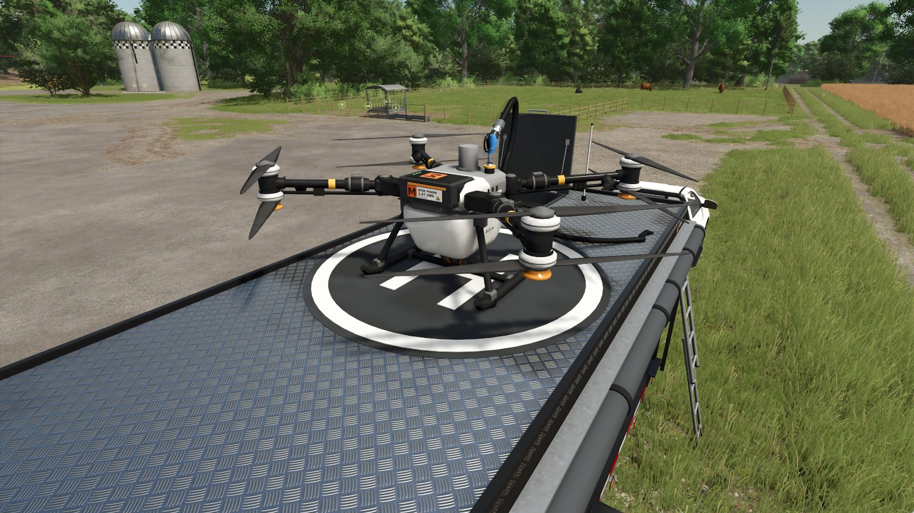
*In game: the drone on the pad during servicing – it is refilled from the trailer tank through the hose and gets a fresh battery if needed.*

8. The drone takes off, sprays, returns to be serviced, and repeats until the field is done ("field is finished"). You can leave the trailer; the flight continues.
9. **Return home** any time: `Space` in the planner or **`Alt+0`**. Starting again continues only where the field is still untreated.
10. Fold the trailer with **`X`** once the drone has landed and the propellers have stopped.

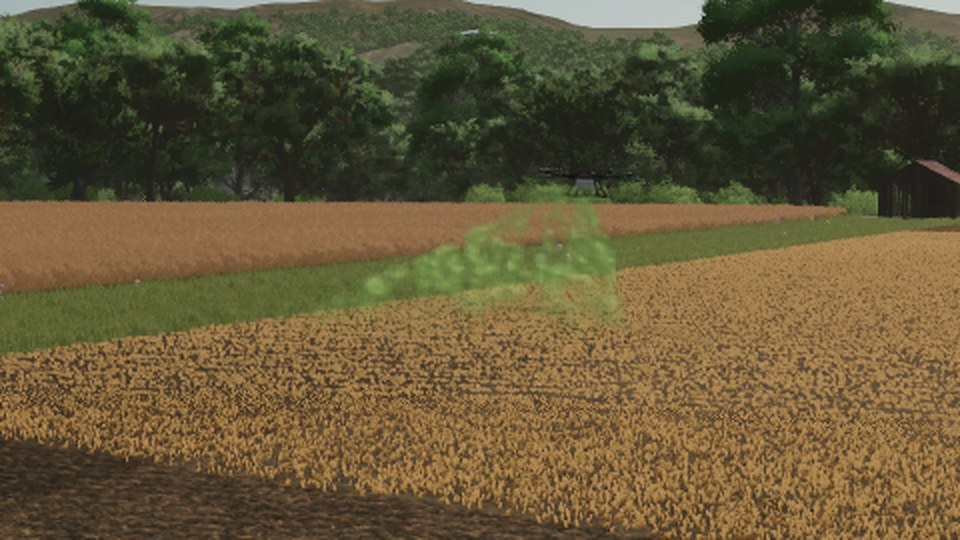
*In game: the drone (small dark shape at the top of the mist) sprays a row; the green mist colour means liquid fertilizer (herbicide is blue, lime white, water grey-blue).*

---

## 5. Controls

### 5.1 On foot

| Key | Action |
|---|---|
| **`R`** | Take / place / store things: mount or remove the drone, insert or take a battery, take / connect / release a hose, pour a canister, open the case lid, canister menu at the cabinet, unfold or fold the relay pole, store or take the pump or the pole at their holders. |
| **Left mouse button** | Use the held tablet (opens the planner); click a trailer display (opens the planner); open/close canister box lids; click machine controls (mill switch box, valve levers, pump inlet switch, hopper legs); at the open sampler case: send samples. |
| **`B`** | Machine on/off: pump, hopper engine, mill engine, generator (at its exhaust), relay pole (unfolded). |
| **`X`** | Fold / unfold the trailer (and the lime mill trailer). |
| Middle mouse | Rotate a carried canister. |

If several actions are available, the game offers the **nearest** one; aiming the crosshair at the object makes it count as 1.5 m closer.

### 5.2 In the trailer (as pilot)

| Key | Action |
|---|---|
| **`Alt+7`** | Open flight planner |
| **`Alt+8`** | Start flight (a field must be selected) |
| **`Alt+0`** | Return to trailer |
| **`Alt+9`** | Drone view (camera on the drone); `C` switches between drone and trailer view |
| `Alt+5` | Show / hide the lines drawn in the world (range, route, field outline, flight area) |
| `Alt+1` | Drain the drone's tank into the trailer (press again to stop) |
| `Alt+2` | Pump the trailer tank into an IBC within 6 m (press again to stop) |
| `Ctrl+I` | Drain the concentrate tank into canisters / onto the ground |
| `B` | Generator on/off (also from the tractor with the trailer selected) |
| `X` | Fold / unfold |

All actions are normal game input actions, so they can be **re-bound** in the controls menu. `Alt+1` and `Alt+2` are always registered but hidden from the help panel when they do nothing; pressing them then does nothing, so the tractor's cruise-control keys are not disturbed.

### 5.3 In the planner

| Key | Action |
|---|---|
| `Enter` | Start flight |
| `Space` | Return home |
| `Esc` | Close |
| `End` | Restart the field from the beginning (for the sampler: send samples) |
| `X` | Draw / edit the **flight area** (see 7.4) |
| `C` | Remove last point while drawing |
| `Backspace` | Delete the flight area |
| `Q` / `E` | Change the selected setting; on the Fields and Scan-map pages, flip pages |
| `PageUp` / `PageDown` | Switch to the next/previous drone or case |
| Mouse | Click = select field; drag = pan; wheel = zoom |

---

## 6. Filling the trailer

The trailer has three tanks:

1. **Main tank** – water, ready-made liquid fertilizer, herbicide (and lime slurry, see chapter 10).
2. **Diesel tank** (30 l) for the generator.
3. **Concentrate tank** – concentrated fertilizer, concentrated herbicide or fine lime. Capacity is 5 % of the main tank.

### 6.1 Ready-made product ("direct")
Fill liquid fertilizer or herbicide into the main tank (from a loading station, IBC or a vanilla tank). The drone is refilled from it; the concentrate is not used.

### 6.2 Water + concentrate ("mix")
Fill the main tank with **water** and the concentrate tank with **concentrate** (from 20 l canisters – tilt the canister over the filler neck on the induction tank). While refilling the drone, the mixer takes water and concentrate in the right ratio at the same time:

| Product | Mixing ratio |
|---|---|
| Liquid fertilizer | 5 % concentrate + 95 % water |
| Herbicide | 5 % concentrate + 95 % water |
| Fine lime | 20 % lime + 80 % water |

One 20 l canister therefore makes 400 l of product. The planner shows what is available and what limits it:
*"Mixing: water + concentrate (5 % concentrate, 95 % water) → Liquid fertilizer"*, *"350 l of product available (limited by water)"*.

Messages: **No concentrate** (water in the main tank, concentrate empty) · **No water** (concentrate present, main tank empty) · **Trailer empty**.

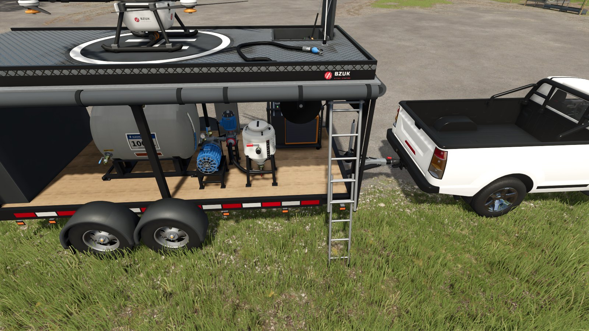
*In game, right side: main tank, pump and mixer (blue), the white induction tank for concentrate, the folded-down ladder, and on the deck the charger chest with the hose coiled beside the pad.*

### 6.3 Canisters and the canister cabinet

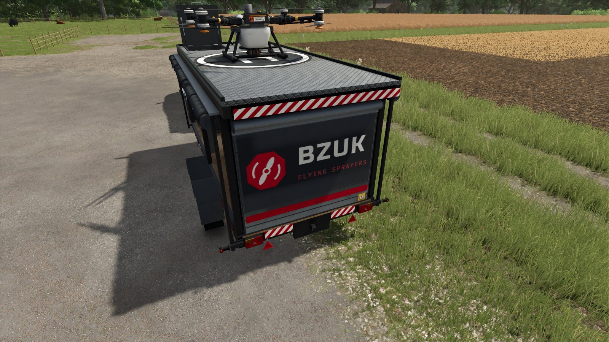
*In game, rear: the roller door of the canister cabinet (48 slots).*
Canisters (20 l: fertilizer concentrate, herbicide concentrate, diesel) are real objects bought in the shop. Hold one over the **open** box and it is stored; empty canisters and canisters over 20 l are not accepted. Left-click opens/closes the lid (Mini: two boxes) or the roller door (Middle/XL); **`R`** shows the canister menu, from which you take canisters out or drain the concentrate tank into new canisters. There is no direct pouring from the cabinet into the tank – only from a canister in your hands.

---

## 7. The flight planner

Open with `Alt+7`, display click or tablet. The planner is a full-screen game map centred on the trailer, with a dark panel on the left and a **plan card** on the right.

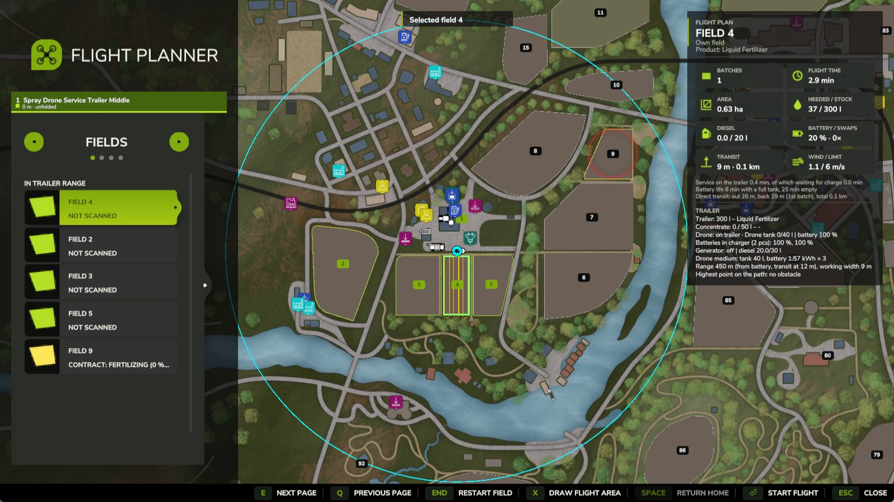
*In game: the planner with field 4 selected. Left: page selector and field list; centre: map with the cyan range circle and the route (yellow-orange rows); right: the plan card.*

### 7.1 Map symbols

| Symbol | Meaning |
|---|---|
| Orange square "VLEK" / trailer | The trailer |
| Cyan square | The drone in the air |
| Cyan circle | Radio range |
| Field outlines | green = your fields, gold = contracts, grey = out of reach / not allowed, thick green = selected, white + bubble = under the cursor |
| Coloured lines | Route; **colour = batch** (one batch = one tank/battery load) |
| White dashed lines | Transit flights trailer ↔ batch (along the real, smoothed path) |
| Red dots | Obstacles with their height in metres |
| Purple area | Flight area (see 7.4) |
| Dots in coloured tiles | Scan map layers (chapter 11) |

### 7.2 Left panel – four pages
(Switch with the page dots, or `Q`/`E`.)

- **Fields** – list of fields in range where the drone may work (own and contract), plus other own fields. Each row shows the most urgent scan finding (weeds, ripe, no lime, unfertilized) and the age of the scan map. Click = select and centre the map.
- **Mission** – mission type (spraying / field scan – the scan mode is set by the drone type), application mode (*whole field / by scan*), number of drones on mission (XL).
- **Flight** – transit height, clearance above and beside obstacles, number of headland rounds, whether to start with headlands or rows.
- **Scan map** – the map layer to show, and the legend of route colours and ranges.

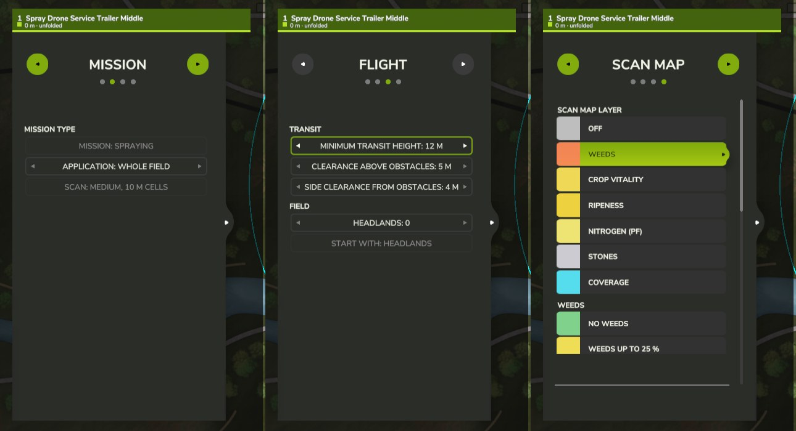
*In game, the other three pages. Defaults on the Flight page: minimum transit height 12 m, clearance above obstacles 5 m, side clearance 4 m, headlands 0.*

### 7.3 Plan card
Shows: field name, product, coloured warnings (red = cannot fly, orange = caution, green = done, purple = flight area), and tiles with: **batches**, **flight time**, **area**, **needed / in stock** (litres), **diesel**, **battery per batch / swaps**, **transit** (height and length), **wind / limit**. Below: service time on the trailer (including waiting for charging), battery life, saving from a scan, and the trailer state (tanks, mixing, drones, batteries, generator, range, highest point on the path).

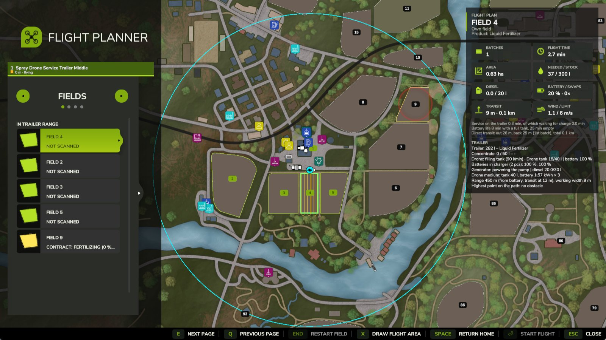
*In game: the same planner during a flight. The trailer line shows "flying"; the plan card shows the drone being refilled (18 / 40 l) and the battery state.*

### 7.4 Flight area (avoiding buildings and trees)
Select a field, press **`X`**, click points on the map to outline a polygon (max. 64 points) that connects the trailer to the field around obstacles. Click the first point (or `X` again, from 3 points) to close it. `C` removes the last point, `Esc` cancels, `Backspace` deletes it. The drone then transits only inside the area or over the field. The area belongs to the field and is saved. If the trailer stands outside it (more than 6 m) or the area does not reach the field, the planner shows a red message and the flight cannot start.

### 7.5 Flight settings
- **Headlands** 0–4 rounds around the field edge; **start with** headlands or rows.
- **Transit height** minimum; the planner raises it automatically over obstacles it finds by ray-casting. If an obstacle exceeds the height limit, move the trailer.
- **Drones on mission** (XL).

### 7.6 How the route works
Parallel rows are computed across the field polygon (back-and-forth), spaced by the working width, clipped by the radio range, and split into **batches**. One batch is as much work as the drone can do with one tank and the battery currently in it, including the trip there and back. The route is recomputed every 5 s in flight, so finished rows disappear. Treated areas are remembered by the game's own field state, so nothing special is saved.

---

## 8. Batteries and the generator

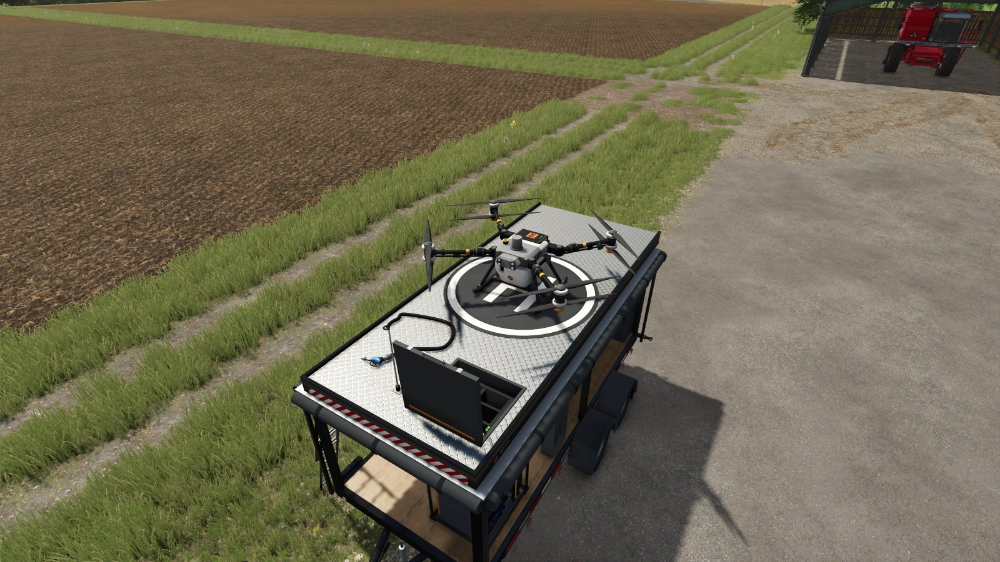
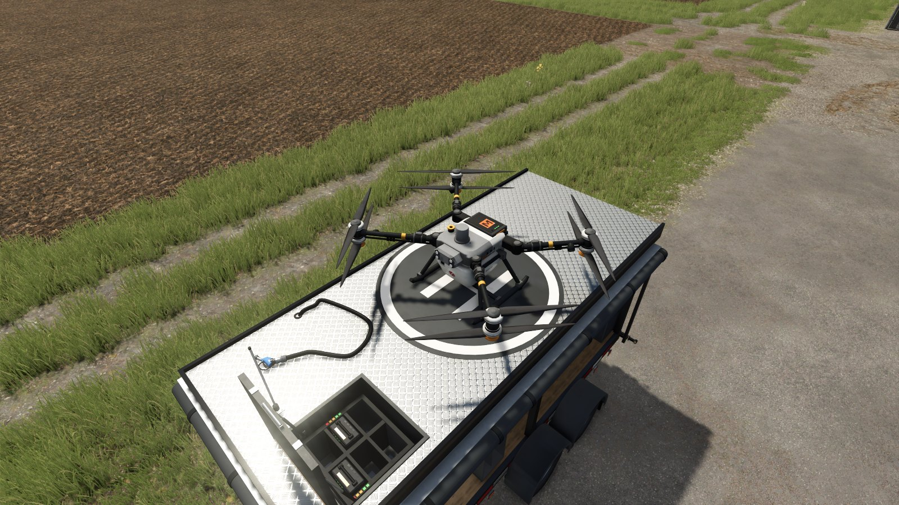
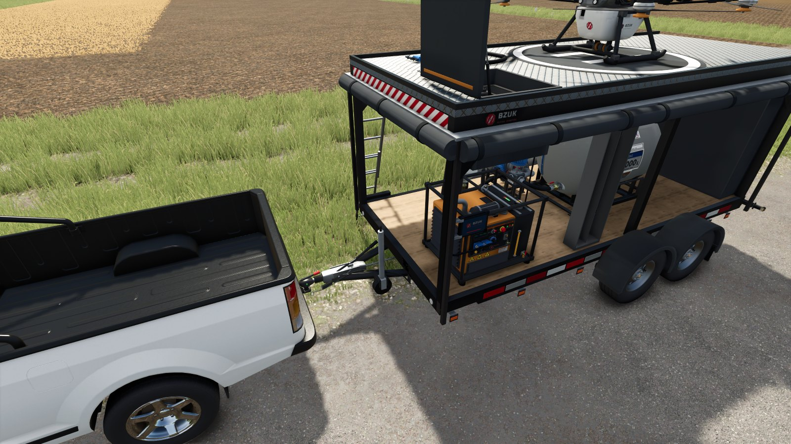
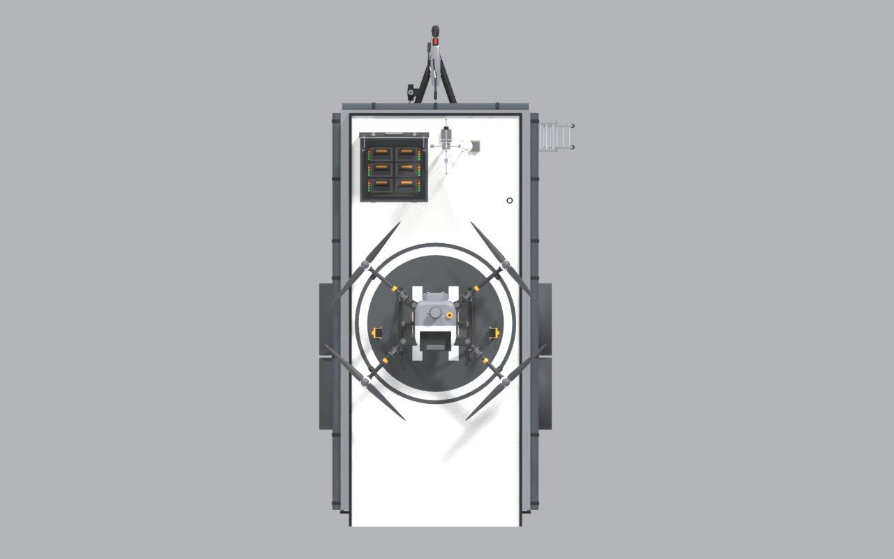

- The drone flies on a battery in the drone. The trailer holds **spare batteries** in the charger chest (Middle/XL) or shaft (Mini). A trailer is bought with 0–6 batteries (Middle), 0–4 (Mini), 0–10 (XL); more can be bought as shop items and inserted with `R`.
- After landing the drone is refilled and its battery is swapped if the charge is **below 30 %** (or if the next batch would not fit). The depleted battery goes into a free charger slot, a **fully charged (≥ 95 %)** one goes into the drone.
- If no battery is charged, the drone **waits** ("waiting for battery charge – X %").
- The **diesel generator** charges all discharged spare batteries at once. It runs whenever it is switched on, has diesel and some spare battery is not full – even with the trailer folded and nobody there. **Switch it on with `B`.** A switched-off generator does not charge, even in a mission.
- Consumption: about 0.37 l of diesel per M battery charged from 30 to 95 % (in about 10 minutes). If diesel runs out the mission ends ("generator out of diesel").
- Batteries in the drone are not charged while it is in the air. When the trailer is folded, the battery flies back into the charger chest before the lid closes.
- A drone with **no battery** will not take off.

The planner calculates all of this in advance (service time, waiting for charge, diesel need vs. diesel in the generator).

---

## 9. Range, relays, antennas, tablet

The drone stays connected by radio. Base range: S 300 m, M 450 m, L 600 m; the circle is shown on the map and in the world. The range is also limited by what the battery can do (round trip with a reserve of 30 s).

- **Antennas** (Middle/XL, shop configuration): base ×1.0, amplified ×1.35, large directional ×1.7. **RTK GPS** gives 15 % less consumption and, in scan mode, a smaller safety margin.
- **Relay pole** (shop, ~$650): carry it, stand it upright on the ground, `R` unfolds it (tripod + telescopic mast), `B` switches it on. An active relay inside the trailer's range extends the range by its distance. A **directional relay pole** covers only a 99° sector in front of it with a 1.75× longer reach – set it up facing the field. A pole can be stored in a holder on the trailer (it charges there).
- **Tablet** (shop, ~$400): hold it and left-click to open the planner of the nearest unfolded trailer or case within radio range. Without connection you see **NO CONNECTION**; leaving the signal closes the planner.

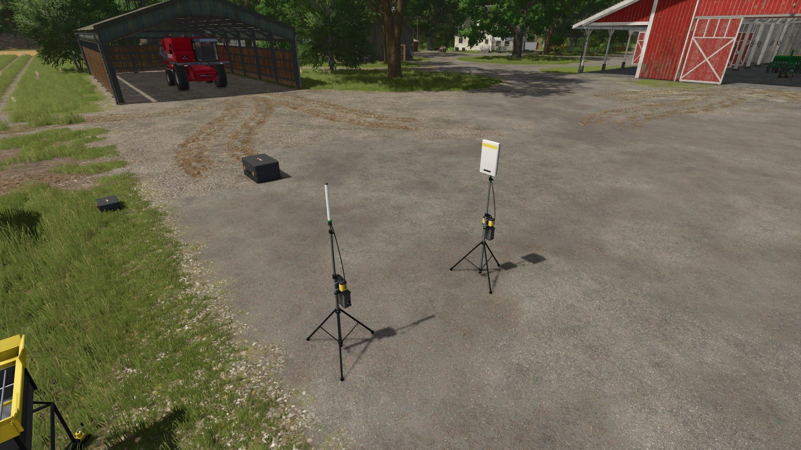
*In game: the two relay poles, unfolded. Left: the omnidirectional pole with the telescopic mast and a white tip. Right: the directional pole with the flat panel; its **front is the side with the wide yellow stripe at the top** – stand it with the front towards the field.*

How to set one up: carry the folded pole (it is a hand-carried object) to a place **inside the trailer's radio range**, put it down upright, press **`R`** next to it (legs spread, mast extends in about 3 s) and **`B`** (the green LED lights). Folded, switched-off, tipped-over or carried poles do nothing. The planner then draws the extended range as a second circle (omni) or a wedge (directional) in the legend colours *"relay pole range"*. Poles can be stored on the trailer: `R` at the holder.

### 9.1 Relay pole parameters

| | **Omnidirectional relay pole** | **Directional relay pole** |
|---|---|---|
| Price (shop, Equipment) | $650 | $900 |
| Stronger variant (surcharge) | 400 m, +$450 | 700 m, +$450 |
| Pole reach – standard | 300 m around the pole | 525 m in a sector |
| Coverage shape | circle | 99° sector in front of the pole |
| Orientation | irrelevant | front (side with the wide yellow stripe) towards the field |

The trailer's range is extended by the distance of the active relay from the trailer, provided the relay itself is inside the trailer's radio range. Relays therefore chain the range: place one at the edge of the current circle and the field beyond is covered.

### 9.2 How a relay changes the range (planner map)

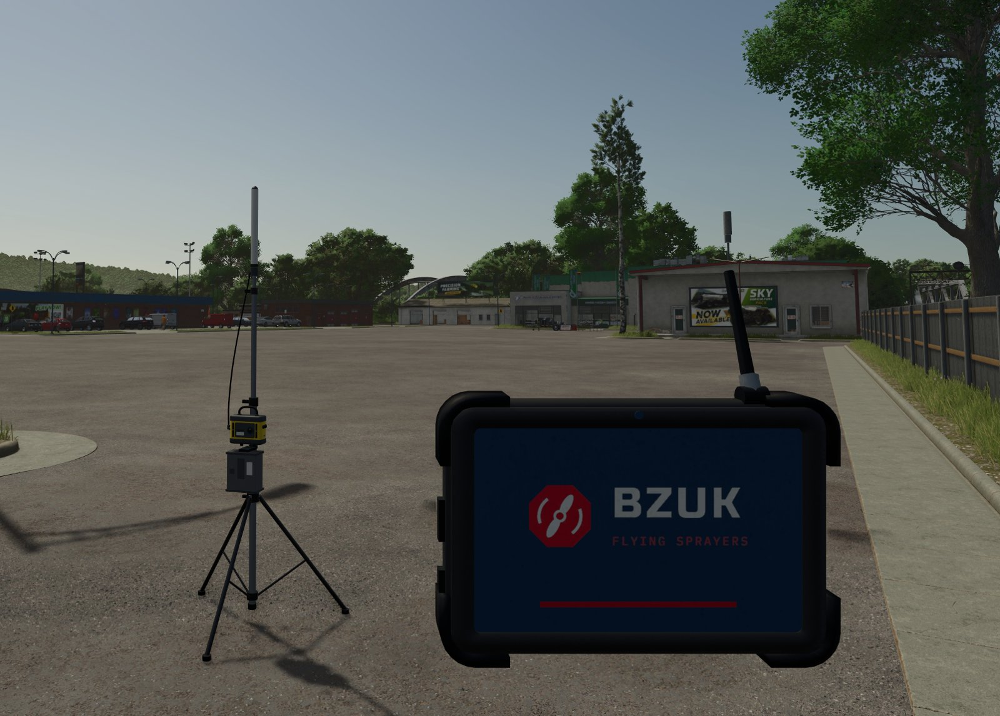
*The omnidirectional relay pole (left) with its telescopic mast, and the BZUK tablet (right) that opens the planner.*

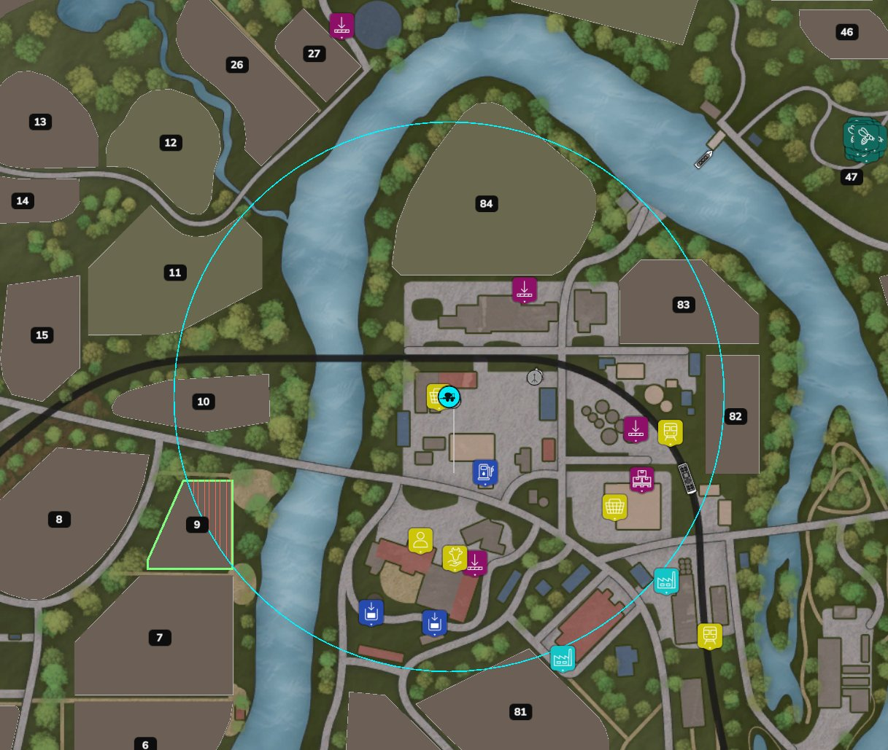
*Without a relay: only the **cyan circle** of the base range around the trailer. Field 9 (green outline) lies right at its edge; fields further west and south are out of range.*

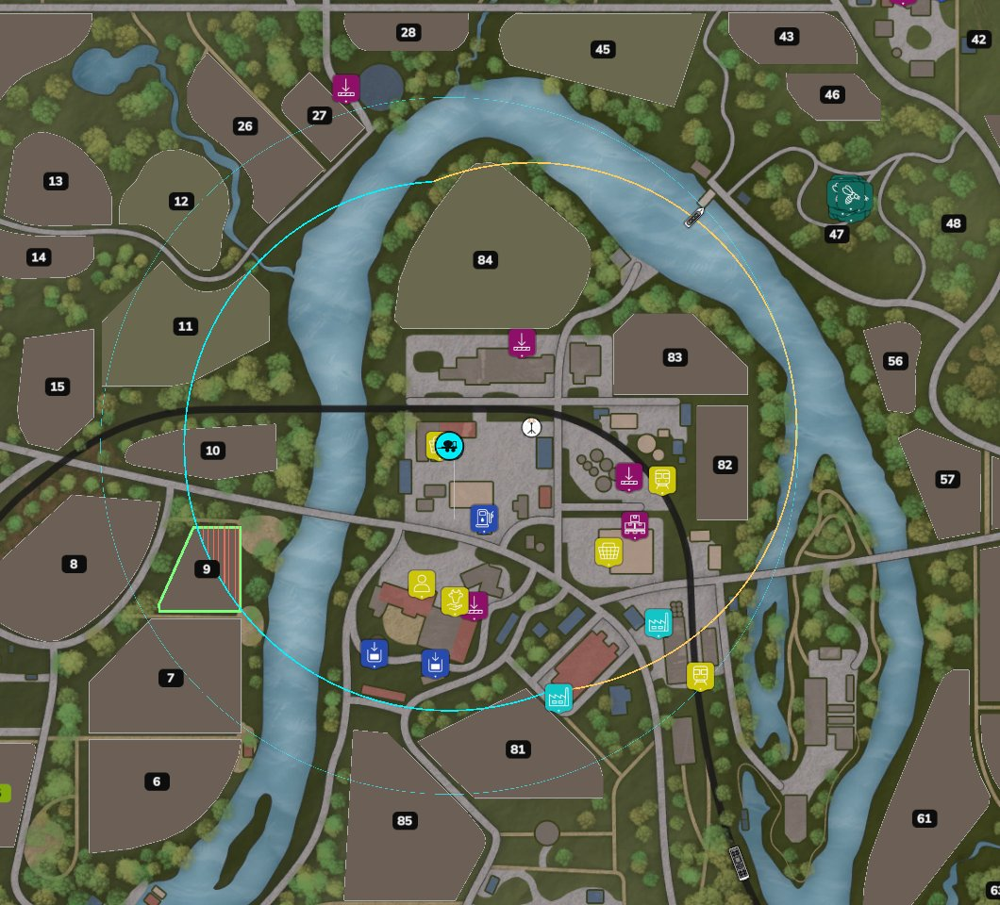
*With an omnidirectional relay pole: a **yellow circle** appears around the relay (white pole marker); coverage extends to fields that were previously out of range.*

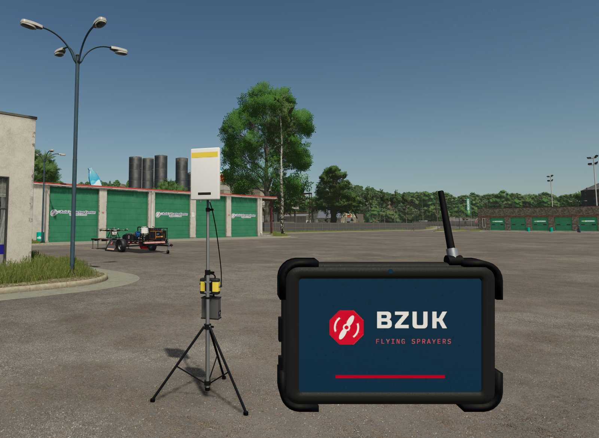
*The directional relay pole: a flat panel on a tripod. Its front is the side with the **yellow stripe at the top**.*

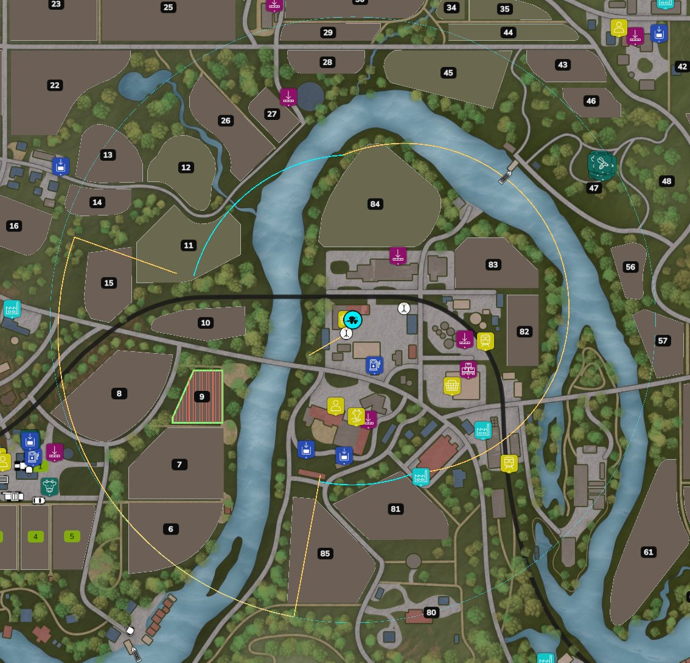
*With a directional pole: the range appears as a **yellow sector** – long, but only within 99° in front of the pole. Behind it and to the sides the range does not grow.*

Practical rules: for fields in one direction use the **directional** pole (reaches further, 525 m instead of 300 m, but only in a sector; $900); for fields all around use the **omnidirectional** one ($650). The stronger shop variant increases the radius by a third. The pole must be unfolded (`R`) and switched on (`B`).

---

## 10. Water, lime and logistics equipment

### 10.1 Water pump (portable)
A diesel pump with an **inlet** (blue) and an **outlet** (red) coupling and two hoses of its own.
- **Inlet** has two modes, switched by left-click on the inlet coupling (only with the engine off and the hose not connected): **tank** (Storz coupling to an IBC/cistern/water trailer) or **pond** (suction strainer: carry the end to the water and press `R` to lay it below the surface).
- **Outlet**: hose to a water valve on the trailer (or any tank that accepts water).
- `B` starts/stops the engine; the pump delivers 16 l/s. Diesel (15 l) is poured from a canister. The pump can be stored in a holder on the trailer.

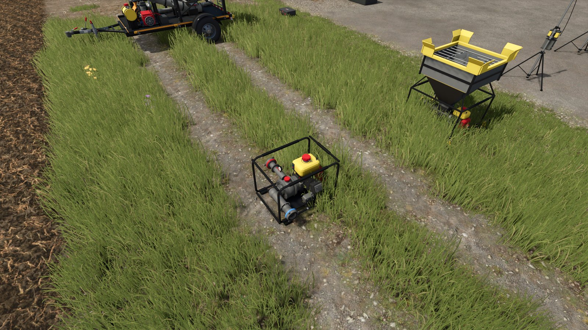
*In game: the pump. A diesel engine (yellow tank, red engine) with a frame; the **blue** coupling is the inlet, the **red** coupling is the outlet.*

### 10.2 Hoses – what connects where

All hoses are handled the same way: **`R`** at a coupling picks up the free end, **`R`** at the matching socket plugs it in, **`R`** at the socket or the coupling again unplugs it (the hose is dropped back and coils up).

| Hose | Starts at | Ends at | Flow / length | Notes |
|---|---|---|---|---|
| **Trailer water hose** (Middle, XL) | A **water valve** under the main tank (one per tank; the XL has one per tank A/B) | Any vehicle or tank holding water: IBC, cistern, water trailer, sprayer | 12 l/s, 12 m | Fills the trailer from the source. Connected to an **empty** foreign tank it pumps the trailer's water into it. A tank holding a different product refuses ("mixed"). |
| **Trailer lime hose** (Middle, XL) | The **lime inlet** on the white induction tank (right side, with a tap lever) | The **outlet of the lime mill** or of the **lime hopper** (Storz coupling) | 8 l/s | Open the tap with a left-click on its lever. The mill/hopper engine must run and contain fine lime. |
| **Pump inlet hose** (blue) | The **blue inlet coupling** of the pump | Mode **tank**: the outlet of an IBC / cistern / water trailer. Mode **pond**: lay the strainer into water (`R` on the water, depth ≥ 15 cm). | 16 l/s, 10 m | Switch the mode by left-click on the inlet coupling – only with the engine off and the hose unplugged. |
| **Pump outlet hose** (red) | The **red outlet coupling** of the pump | A **water valve of the trailer** or any tank that accepts water (cistern, IBC, sprayer) | 16 l/s, 12 m | The engine must run (`B`). Needs a free valve within 12 m; a different product in the target tank blocks it. |
| **Drone fill hose** | The reel / coil on the trailer deck | The **fill port of the drone** | Pump speed of the drone (1 – 2.5 l/s) | **Automatic.** During servicing the nozzle swings to the drone, fills it, and returns. The XL has one reel per drone. |

#### Set-up 1 – water: IBC → pump → trailer

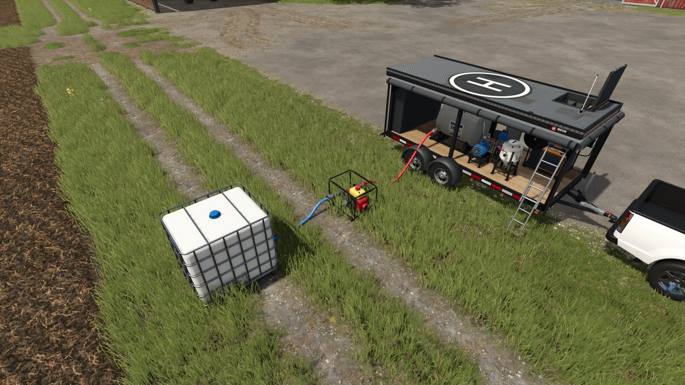
*In game: the whole chain, drawn close together. **IBC with water** → **blue hose** → **pump** → **red hose** → **water valve of the trailer**.*

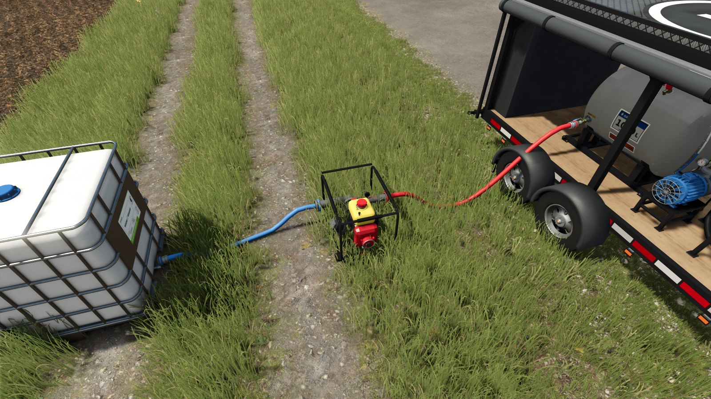
*The pump close up. The blue hose goes from the **inlet** (blue coupling) to the outlet of the IBC; the red hose leaves from the **outlet** (red coupling) and runs to the trailer.*

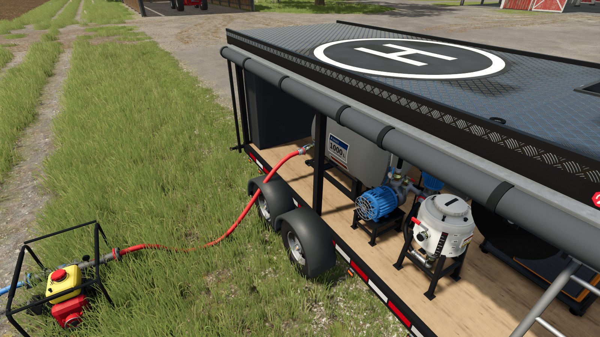
*The red hose ends in the **water valve under the main tank** of the trailer (right side, behind the axles).*

##### Variant: filling from a pond

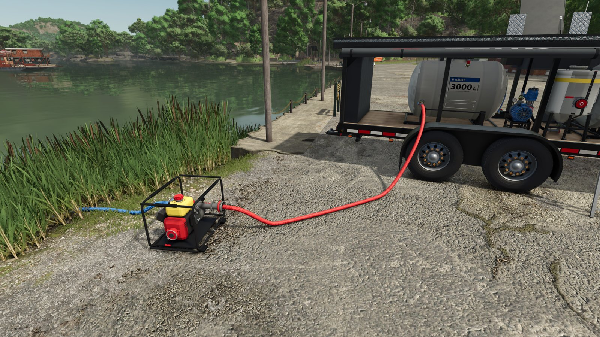
*The pump stands on the bank. The **blue suction hose** runs into the water (strainer under the surface, inlet mode *pond*), the **red outlet hose** runs to the water valve under the trailer's tank (3000 L label).*

##### Variant: water from an IBC directly with the trailer (no pump)

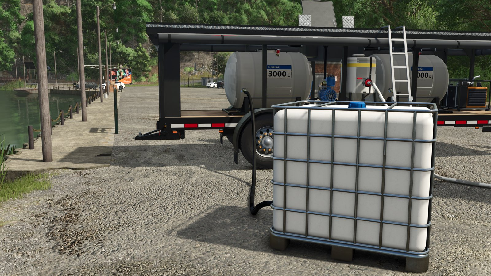
*The black **trailer water hose** runs from the water valve under the tank straight into the IBC. Good for transferring from and to an IBC (12 l/s).*

##### Variant: water from a tanker

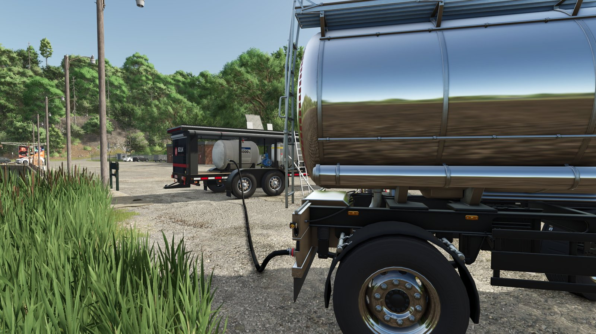
*The same with a tanker: the trailer hose is plugged into the tanker outlet (trailer in the background). The tanker must contain water, otherwise the connection is refused ("mixed").*

How to do it: place the pump between the IBC and the trailer (the IBC no further than about 10 m from the pump, the valve within 12 m). Take the blue hose from the pump (`R` at the inlet coupling, pump inlet mode *tank*) and plug it into the IBC with `R`; take the red hose (`R` at the outlet coupling) and plug it into the valve of the trailer with `R`; start the pump with `B`. The trailer tank fills at up to 16 l/s.

#### Set-up 2 – lime from the hopper: hopper → trailer

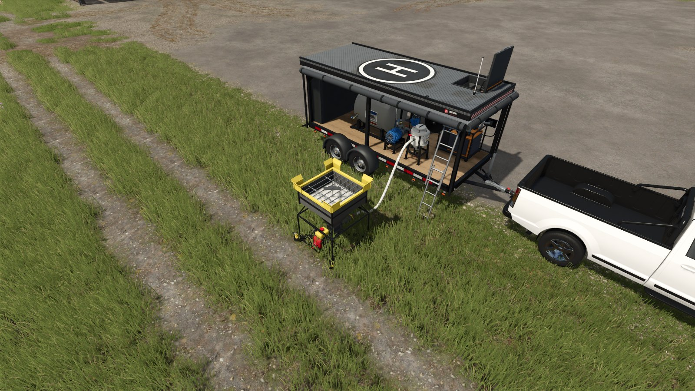
*In game: the **lime hopper** stands beside the trailer; the **white hose** runs from the hopper's outlet (Storz coupling on its side) to the **lime inlet on the white induction tank**.*

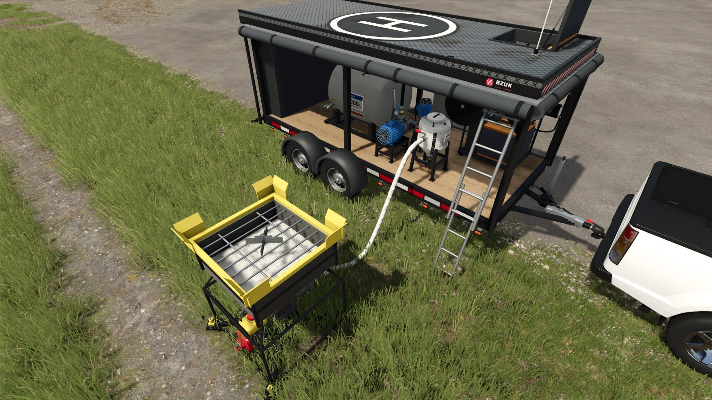
*Close-up: the hopper's outlet on the side facing the trailer, and the hose going up to the deck.*

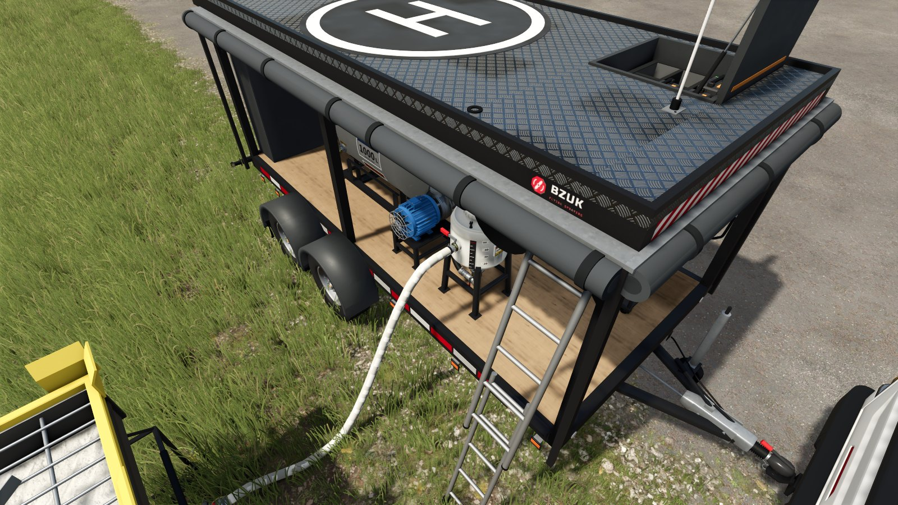
*The hose plugged into the **lime inlet of the induction tank** (trailer, right side – same side as the ladder). The tap lever of the inlet must be open.*

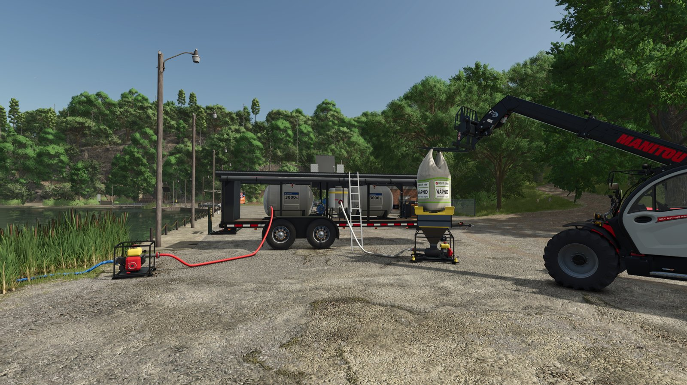
*The whole station together: pond pump with water on the left (red hose), the hopper on the right with a **lime big bag** placed by a telehandler; the **white hose** runs from the hopper to the lime inlet. Water and lime fill the trailer at the same time.*

How to do it: pour lime into the hopper (50 l bags or a big bag on its stool, legs extended), start its engine with `B`. Take the trailer's lime hose at the inlet (`R`), plug it into the hopper outlet (`R`), open the tap with a left-click on its lever. The lime flows at 8 l/s into the induction tank.

#### Set-up 3 – lime from the mill trailer: mill → trailer

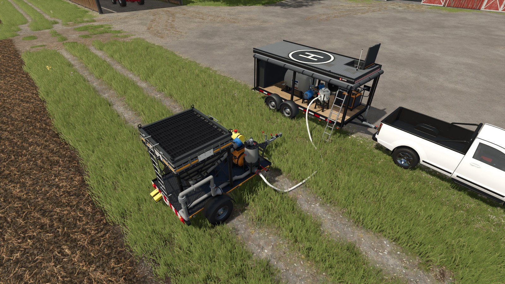
*In game: the **lime mill trailer** parked beside the service trailer; the white hose runs from the mill's outlet to the lime inlet.*

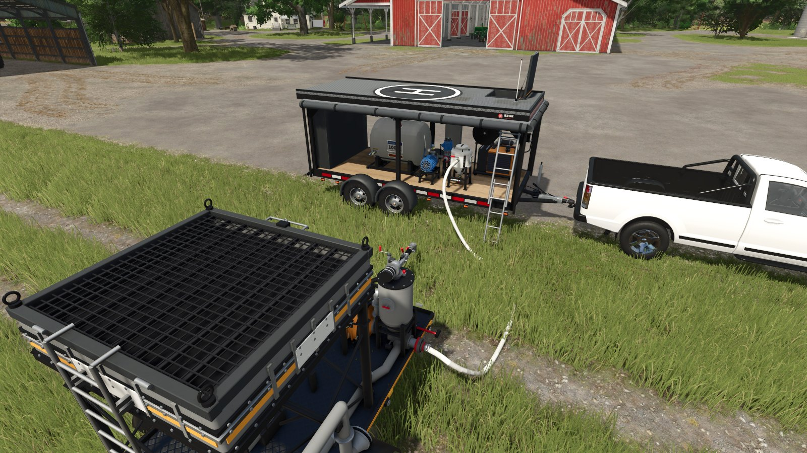
*Close-up: the outlet of the mill (cylindrical buffer with the Storz coupling) on the side towards the trailer.*

How to do it: coarse lime goes into the bin on top of the mill; start the engine (`B`); set the valve lever to **hose**; plug the trailer's lime hose into the mill outlet. (The same lever set to **spout pipe** fills a big bag instead – see 10.3.)

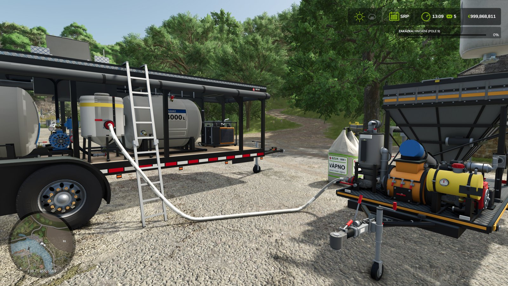
*The finished connection from the side: the **white hose** from the mill outlet (right) to the white **lime inlet on the induction tank** (left, beside the ladder). A big bag of lime stands behind the mill.*

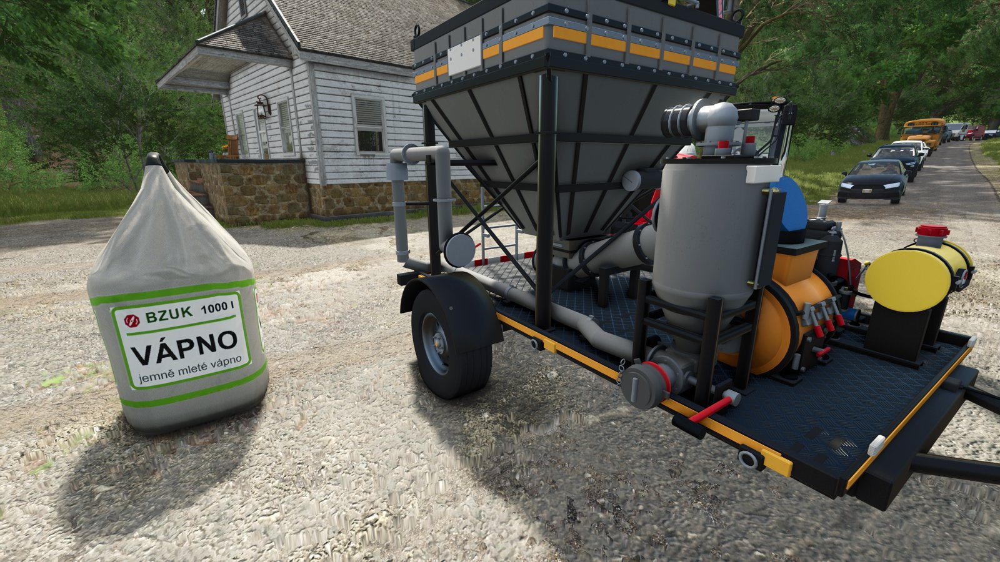
*The other option: set the mill's valve lever to the **discharge pipe** – the fine lime flows into a **big bag** (label *VÁPNO – finely ground lime*, 1,000 l). Take the big bag away and place it on the hopper (Set-up 2).*

#### Set-up 4 – herbicide in an IBC next to the trailer

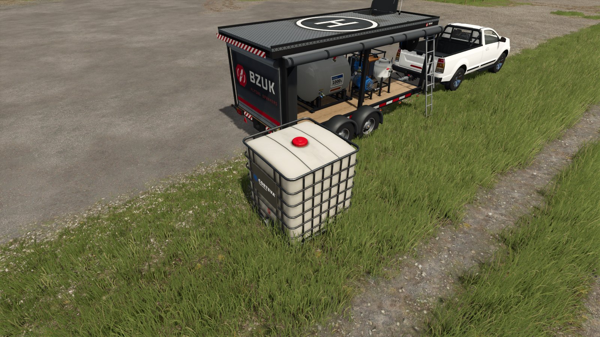
*In game: a vanilla **IBC with herbicide** parked within 6 m of the trailer.*

The trailer's tank can be pumped **into** such an IBC with **`Alt+2`** (the IBC must be within 6 m; press again to stop) – handy for emptying leftover product. Herbicide gets **into** the trailer either ready-made at a loading station, or as **concentrate**: put the 20 l herbicide canisters into the cabinet or pour them into the induction tank and fill the main tank with water (see chapter 6).

#### Quick reference – typical set-ups
- **Fill from a pond:** pump inlet hose → strainer in the pond (mode *pond*); pump outlet hose → trailer water valve; start the pump with `B`.
- **Fill from an IBC:** inlet in mode *tank* → IBC outlet; outlet → trailer valve. (Or skip the pump and use the trailer's own water hose from its valve to the IBC.)
- **Empty the trailer into a cistern:** trailer water hose from the valve to the empty cistern.
- **Lime:** mill or hopper outlet → trailer lime hose → induction tank lime inlet; open the tap, run the engine.

### 10.3 Liming
Liming is a mixer product: fine lime (`Fine ground lime`) is a concentrate at 20 %, the drone sprays `LIME`. Works on bare soil, stubble or freshly sown fields, and only when lime is required in the game settings.

Workflow for fine lime:
1. **Lime mill trailer** (shop, ~$16,500; hitch it behind the XL or any tractor): coarse lime from a vanilla trailer or big bag goes into its bin; a diesel engine drives auger and hammer mill (6 l/s). `B` on foot at the switch box (or in the trailer) starts the engine. Fine lime goes into a 150 l buffer.
2. **Valve lever**: horizontal = **hose**, vertical = **spout pipe**. Switch with a left-click on the lever, or `Y` from the vehicle. Hose mode needs a hose to the trailer's lime inlet (valve open); the spout mode needs the pipe (`O` cycles transport → beside → behind) and a standing trailer – it fills a **big bag** under the spout.
3. **Lime hopper** (shop, ~$2,400): a portable hopper with its own engine. Feed it with 50 l bags (tilt over the funnel) or a big bag placed on its stool (legs must be extended first – left-click on a foot). It feeds the trailer's lime inlet through a hose.

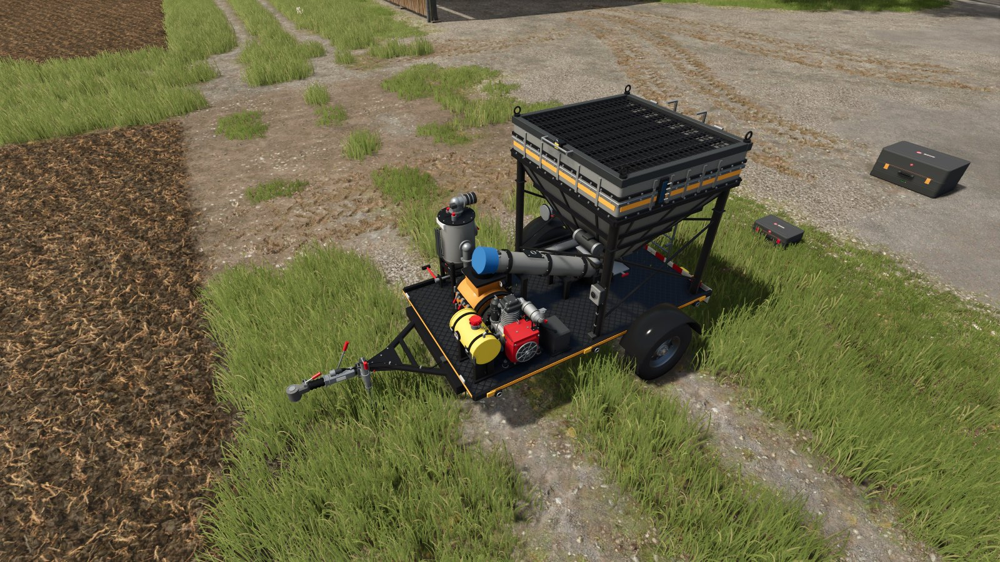
*In game: the lime mill trailer: the black bin on top takes coarse lime, below it the auger and mill with the diesel engine (yellow tank) and the cylindrical buffer for fine lime with the Storz outlet on its side.*

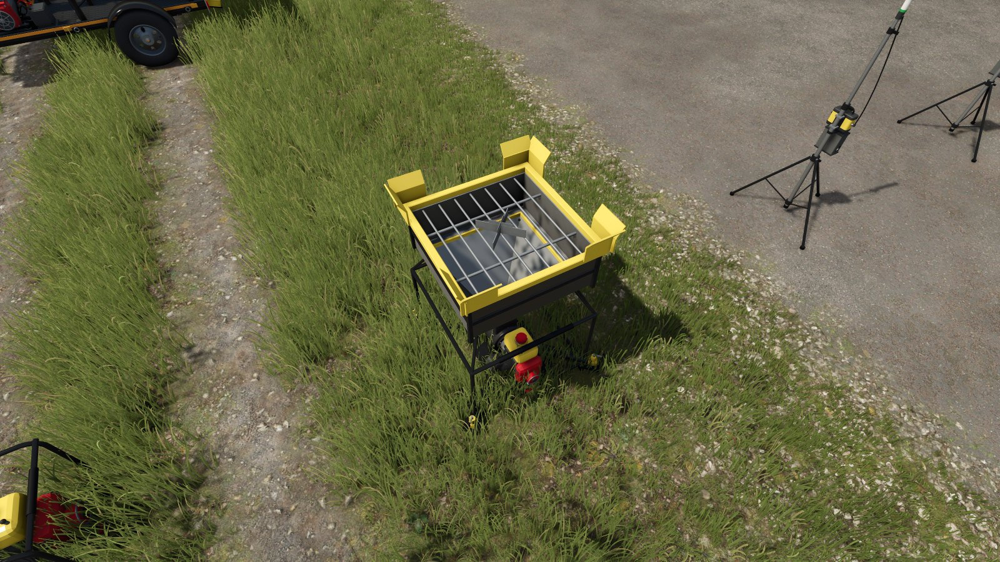
*In game: the lime hopper with its yellow stool; bags or a big bag go on the grate, and the fine lime leaves through the Storz coupling at its side to the trailer's lime hose.*

### 10.4 Product loop summary
Coarse lime → mill → (hose → trailer) or (big bag → hopper → hose → trailer) → concentrate tank → mixed with water at 20 % → drone.

| What you want | Source | Path | Where |
|---|---|---|---|
| Fill water from a pond | pond | strainer → pump (mode *pond*) → trailer | Set-up 1, pond variant |
| Fill water from an IBC | IBC | IBC → pump → trailer, or the trailer hose directly | Set-up 1 |
| Fill water from a tanker | tanker | trailer hose from the valve to the tanker outlet | Set-up 1, tanker variant |
| Lime straight into the trailer | coarse lime | mill hopper → mill (lever on **hose**) → hose → lime inlet | Set-up 3 |
| Grind fine lime into a big bag | coarse lime | mill (lever on **discharge pipe**) → big bag | Set-up 3, 10.3 |
| Lime from a big bag / bags | big bag, bags | hopper → hose → lime inlet | Set-up 2 |
| Herbicide | IBC, canisters | ready-mixed from a filling station, or concentrate + water | Set-up 4, chapter 6 |

---

## 11. Scanning, spot application and soil sampling

### 11.1 Scan case (portable scout drone "C")
A suitcase with a scan drone and two batteries (~$9,750). `R` opens the lid, the landing pad is laid out beside the case, then the drone unfolds. Closing is only possible with the drone home and propellers stopped. It is controlled from the **tablet** (or planner within range). It scans **your own fields only** and never sprays; the drone does not take off from the case itself.
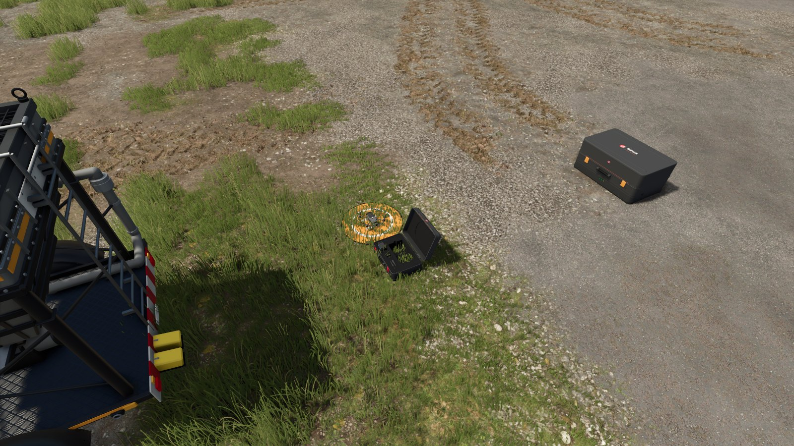
*In game: the scan case with the lid open and the round landing pad unrolled beside it (the second, closed black case in the background is the sampler case).*

- **Charging**: batteries charge within 15 m of a farm building (house, workshop, silo, shed with indoor area, charging station) or a **running trailer generator**.
- Range is shorter: 500 m (scan case).
- A scan needs daylight, no rain and wind below 12 m/s. Cell size options: low (5 m cells, 8 m height), medium (10 m / 15 m), high (20 m / 30 m).
- A scanned cell records weeds (also the invisible early stage), crop vitality, growth stage, stones. Lime and pH are **not** read by the scan.

### 11.2 Scan map
Scanned cells appear in the planner in colour by layer (weeds, lime, fertilization/vitality, ripeness, stones, coverage, and with Precision Farming nitrogen and pH). Cells older than 48 game hours are faded. After treatment, cells turn blue ("treated since scan").

### 11.3 Application by scan (spot spraying)
In the planner set **Application: by scan**. The drone then treats **only** the selected cells (with a safety margin of 6 m, 1.5 m with RTK): herbicide where weeds are, lime where lime is missing, fertilizer where the level is low. With Precision Farming, lime uses the pH map (only on cells where the farm took samples) and fertilizer the nitrogen target of the crop. The planner compares *whole field* with *by scan* (litres, minutes, saving).

### 11.4 Sampler case (AIRASI soil sampling, "P", needs Precision Farming)
Case (~$14,600) with a sampling drone, two batteries and a **24-slot sample box**. The drone flies to each grid point (spacing from the PF sample density), lands, drives a four-stage probe into the soil, holds for 3 s, and carries two samples per flight to the box. Send the samples by **left-clicking the box** (or the "Send samples" button / `End` in the planner); Precision Farming's laboratory analyses them and charges per sample. A full box blocks further missions.

---

## 12. Weather and limits

| Condition | Spraying | Scanning | Sampling |
|---|---|---|---|
| Rain | no flight | no flight | no flight |
| Wind limit | S 5 / M 6 / L 7 m/s | 12 m/s | 10 m/s |
| Darkness | allowed | not allowed | allowed |

The planner shows *"Weather: wind 3.1 m/s (limit 6 m/s) – OK / too windy / raining / dark"*. If conditions turn bad **during** a flight, the drone returns home and reports why. The trailer must not move during a mission: if it moves (speed above the limit, or more than a couple of metres), the mission aborts ("trailer moved").

Other limits: obstacles higher than the transit height limit block the route; fields only accepted when your farm owns them or has the contract; a contract is selected as a whole and is only possible with the right product (fertilizing = fertilizer, herbicide mission = herbicide).

---

## 13. Messages and troubleshooting

| Message / symptom | Cause and fix |
|---|---|
| "The trailer is folded – unfold it first" | Press `X`. |
| Cannot unfold | Trailer tilt over 5° – move to level ground. |
| "Propellers are still running down" when folding | Wait until they stop and return to the rest position. |
| "Move the drone into the crate first" (Mini) | `R` at the platform with empty hands. |
| "The drone has no battery" | Insert a battery into the drone or the charger chest. |
| Drone waits on the pad | No spare battery ≥ 95 % – switch the **generator** on, check diesel. |
| "Generator out of diesel" | Pour diesel from a canister. |
| "No concentrate" / "No water" | Fill the missing tank (chapter 6). |
| "Trailer is outside the flight area" / "area does not connect…" | Edit or delete the flight area (`X`, `Backspace`). |
| Field cannot be selected | Out of range, not yours, or the contract needs a different product. |
| "NO CONNECTION" | Outside radio range – move closer or place a relay pole. |
| Drone does not take off in rain/wind | See chapter 12. |
| Pressing `B` does nothing | Another mod may bind `B` (e.g. hand tools); rebind the mod's action. |

---

## 14. Known limitations (status of this version)

- Gamepad control of the planner is not verified (mouse and keyboard only).
- Multiplayer is supported on paper but has been tested only partially; the mod is mainly tested in single player.
- Several newer features have been tested **only through debug commands and offline tests**, not by full manual play: the portable scan and sampler cases, drones as hand-carried objects, the lime big bag / hopper stool and legs, the directional relay pole, Precision Farming nitrogen/pH layers, the pump inlet-mode switching, and the new planner screen with gamepad.
- Sounds were verified from the game log, not by listening.
- Real weather (wind/rain) thresholds were verified with forced values.
- Unfolding does not work on a tilted trailer by design; trailers have no levelling legs.

---

*Appendix – renders of the three trailers from above*

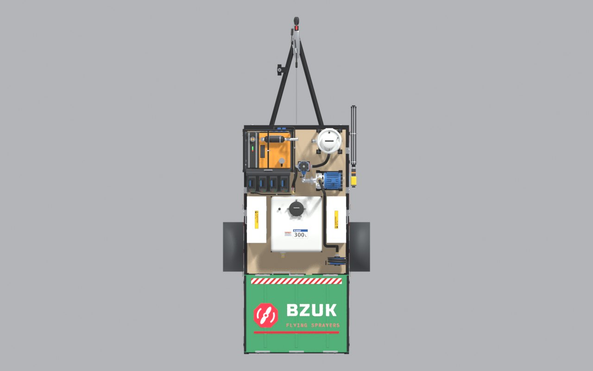
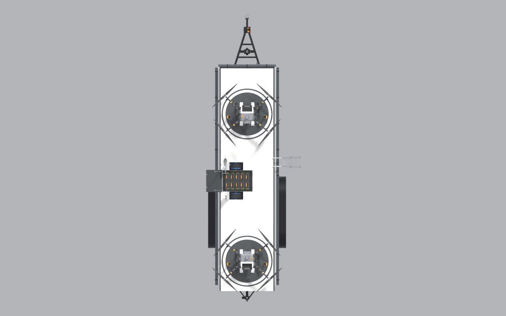
